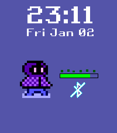
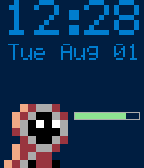

<!-- Generated by scripts/update_app_directory.py: do not edit by hand -->
[← All Pebble Developers](../developers.md)

# 123outerme

*2 watchfaces · Last updated 2026-10-12 · [About these lists](../about-app-lists.md)*

Links: [Pebble App Store](https://apps.repebble.com/apps/dev/123outerme_596a2cc5b67f9f814d001e48) · [Rebble App Store](https://apps.rebble.io/en_US/developer/596a2cc5b67f9f814d001e48/1) · [GitHub (123outerme)](https://github.com/123outerme) · [GitHub (TildaCubed)](https://github.com/TildaCubed) · [Website (123outerme.itch.io)](https://123outerme.itch.io/shards-of-grandeur)

<button type="button" data-filter="all" aria-pressed="true">All 2</button><button type="button" data-filter="watchface" aria-pressed="false">Watchfaces 2</button><button type="button" data-filter="watchapp" aria-pressed="false" disabled>Apps 0</button>

<label class="dev-sort">Sort by <select><option value="updated">Recently updated</option><option value="released">Newest release</option><option value="title">A–Z</option></select></label>

<h2 class="app-name" id="app-69584a4b39d92d0009bb7478"><a href="https://apps.repebble.com/69584a4b39d92d0009bb7478">Shards of Grandeur Watchface</a> v1.3.0</h2>
<a class="app-source" href="https://github.com/123outerme/ShardsOfGrandeurPebbleWatchface" title="Source code" data-search-exclude>View source</a>

Watchface · <a href="https://forum.rebble.io/t/422" title="Discuss this app on the Rebble forum" data-search-exclude>Forum thread</a>

No licence Released 2026-01-02 Updated 2026-06-06

Runs on: Round 2, Time 2, Pebble 2 Duo, Pebble 2, Time Round, Time, Classic

Shows the date, time, battery level, a charging indicator on the battery bar, Bluetooth connection state, and the last heart rate reading (if supported)! Additionally, the watch will vibrate if…

<h2 class="app-name" id="app-597bd041461a8d1889000604"><a href="https://apps.rebble.io/en_US/application/597bd041461a8d1889000604">Sorcery of Watchface</a> v2.3</h2>
<a class="app-source" href="https://github.com/TildaCubed/SorceryofUvutu/tree/PebbleWatchFace" title="Source code" data-search-exclude>View source</a>

Watchface

MIT Released 2017-07-29 Updated 2017-09-20 Rebble App Store

Runs on: Round 2, Time 2, Pebble 2 Duo, Pebble 2, Time Round, Time, Classic

A Sorcery of Uvutu-themed watchface. Uses the TI-84+ Font, the classic Sorcery of Uvutu two-tone blue color scheme, a battery life bar, a charging indicator, and Bluetooth (dis)connect detection.

