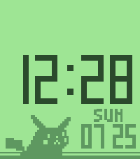

<!-- Generated by scripts/update_app_directory.py: do not edit by hand -->
[← All Pebble Developers](../developers.md)

# 16 Bit Virtual Studios

*2 watchfaces · Last updated 2026-10-12 · [About these lists](../about-app-lists.md)*

Links: [Pebble App Store](https://apps.repebble.com/apps/dev/16-bit-virtual-studios_6d44abb96ffddb74f2e9b268) · [Rebble App Store](https://apps.rebble.io/en_US/developer/5b80a72c09bc1d00018a3824/1) · [Codeberg (the16bitgamer)](https://codeberg.org/the16bitgamer) · [Website (16bitvirtualstudios.com)](https://www.16bitvirtualstudios.com/)

<button type="button" data-filter="all" aria-pressed="true">All 2</button><button type="button" data-filter="watchface" aria-pressed="false">Watchfaces 2</button><button type="button" data-filter="watchapp" aria-pressed="false" disabled>Apps 0</button>

<label class="dev-sort">Sort by <select><option value="updated">Recently updated</option><option value="released">Newest release</option><option value="title">A–Z</option></select></label>

<h2 class="app-name" id="app-ae8e3a693a90459bba914b8c"><a href="https://apps.repebble.com/ae8e3a693a90459bba914b8c">Pokétch DX</a> v1.1.2</h2>
<a class="app-source" href="https://codeberg.org/the16bitgamer/poketech-dx" title="Source code" data-search-exclude>View source</a>

Watchface

Released 2026-07-25 Updated 2026-09-21

Runs on: Round 2, Time 2, Pebble 2 Duo, Pebble 2, Time Round, Time, Classic

Inspired by the watch of the same name in Pokemon DPP. This watch face lets you customize the palette, date and week fields.

<h2 class="app-name" id="app-6a64eac20e86980009060ac6"><a href="https://apps.rebble.io/en_US/application/6a64eac20e86980009060ac6">Poketech DX</a> v1.1.2</h2>
<a class="app-source" href="https://codeberg.org/the16bitgamer/poketech-dx" title="Source code" data-search-exclude>View source</a>

Watchface · <a href="https://forum.rebble.io/t/1187" title="Discuss this app on the Rebble forum" data-search-exclude>Forum thread</a>

Released 2026-07-25 Updated 2026-09-21 Rebble App Store

Runs on: Round 2, Time 2, Pebble 2 Duo, Pebble 2, Time Round, Time, Classic

This is a recreation of the watch of the same name from DPP. With added customization for date, bluetooth, and palettes

