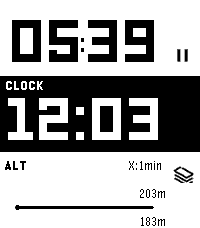
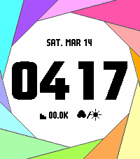

<!-- Generated by scripts/update_app_directory.py: do not edit by hand -->
[← All Pebble Developers](../developers.md)

# 1987haaa

*1 watchface and 1 app · Last updated 2026-10-12 · [About these lists](../about-app-lists.md)*

Links: [Pebble App Store](https://apps.repebble.com/apps/dev/1987haaa_4f73b53120792bffd3b3c1b4) · [GitHub (hag1987haaa)](https://github.com/hag1987haaa) · [Website (hagtime.com)](https://hagtime.com/?p=371)

<button type="button" data-filter="all" aria-pressed="true">All 2</button><button type="button" data-filter="watchface" aria-pressed="false">Watchfaces 1</button><button type="button" data-filter="watchapp" aria-pressed="false">Apps 1</button>

<label class="dev-sort">Sort by <select><option value="updated">Recently updated</option><option value="released">Newest release</option><option value="title">A–Z</option></select></label>

<h2 class="app-name" id="app-6c34b655b63f4f8a918844a8"><a href="https://apps.repebble.com/6c34b655b63f4f8a918844a8">Iron</a> v1.4.2</h2>
<a class="app-source" href="https://github.com/hag1987haaa/Iron-for-Pebble" title="Source code" data-search-exclude>View source</a>

App · <a href="https://forum.rebble.io/t/1113" title="Discuss this app on the Rebble forum" data-search-exclude>Forum thread</a>

MIT Released 2026-06-23 Updated 2026-10-08

Runs on: Round 2, Time 2, Pebble 2 Duo, Pebble 2, Time Round, Time, Classic

Iron - Workout Companion for Pebble Iron is a high-performance, open-source sports tracker for your Pebble smartwatch. Designed for runners and fitness enthusiasts, it tracks your real-time…

<h2 class="app-name" id="app-0ee0abb8756342f58ac5f0a3"><a href="https://apps.repebble.com/0ee0abb8756342f58ac5f0a3">Iris</a> v2.1</h2>
<a class="app-source" href="https://github.com/hag1987haaa/Iris-Public" title="Source code" data-search-exclude>View source</a>

Watchface · <a href="https://forum.rebble.io/t/751" title="Discuss this app on the Rebble forum" data-search-exclude>Forum thread</a>

MIT Released 2026-03-07 Updated 2026-04-06

Runs on: Round 2, Time 2, Pebble 2 Duo, Pebble 2, Time Round, Time, Classic

Meet Iris! 📸 Love cameras? Love big, readable numbers? &quot;Iris&quot; brings a mechanical camera shutter right to your wrist! The aperture dynamically opens and closes, revealing the time in a layout…

