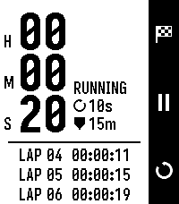

<!-- Generated by scripts/update_app_directory.py: do not edit by hand -->
[← All Pebble Developers](../developers.md)

# 1npo

*1 app · Last updated 2026-11-02 · [About these lists](../about-app-lists.md)*

Links: [Pebble App Store](https://apps.repebble.com/apps/dev/1npo_713ce939b0932043917f0010) · [GitHub (1npo)](https://github.com/1npo)

<h2 class="app-name" id="app-35c1226f5e45465ea288d76c"><a href="https://apps.repebble.com/35c1226f5e45465ea288d76c">Eco Stopwatch</a> v1.1.1</h2>
<a class="app-source" href="https://github.com/1npo/pebble-eco-stopwatch" title="Source code" data-search-exclude>View source</a>

App · <a href="https://forum.rebble.io/t/1427" title="Discuss this app on the Rebble forum" data-search-exclude>Forum thread</a>

MIT Released 2026-10-12 Updated 2026-10-17

Runs on: Round 2, Time 2, Pebble 2 Duo, Pebble 2, Time Round, Time, Classic

Eco Stopwatch is a stopwatch designed to minimize battery usage. Instead of redrawing every second, it updates the screen once every N seconds (10 by default, adjustable from 1 to 60) and once…

