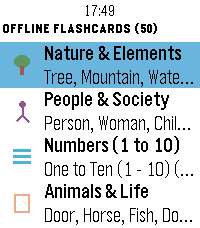

<!-- Generated by scripts/update_app_directory.py: do not edit by hand -->
[← All Pebble Developers](../developers.md)

# 3DTero

*1 app · Last updated 2026-10-12 · [About these lists](../about-app-lists.md)*

Links: [Pebble App Store](https://apps.repebble.com/apps/dev/3dtero_0e22a0bc25408281396a6f0c) · [GitHub (3DTero)](https://github.com/3DTero)

<h2 class="app-name" id="app-e56db32d79bc4a918a6f8c45"><a href="https://apps.repebble.com/e56db32d79bc4a918a6f8c45">HanziWatch</a> v1.5.1</h2>
<a class="app-source" href="https://github.com/3DTero/pebble-chinese-flashcards" title="Source code" data-search-exclude>View source</a>

App

No licence Released 2026-09-11 Updated 2026-09-12

Runs on: Time 2

an interactive Chinese character flashcard app built specifically for Pebble watches. Learn essential Chinese characters on the go with high-contrast Hanzi glyphs, accurate Pinyin with tone marks…

