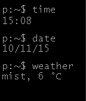

<!-- Generated by scripts/update_app_directory.py: do not edit by hand -->
[← All Pebble Developers](../developers.md)

# 3x14159265

*1 watchface · Last updated 2026-10-12 · [About these lists](../about-app-lists.md)*

Links: [Pebble App Store](https://apps.repebble.com/apps/dev/3x14159265_5603ab0edafe0db575000048) · [GitHub (3x14159265)](https://github.com/3x14159265) · [Website (pichsenmeister.com)](https://www.pichsenmeister.com)

<h2 class="app-name" id="app-561a5d5f1a1d89bb9a00007e"><a href="https://apps.repebble.com/561a5d5f1a1d89bb9a00007e">Console Time &amp; Weather</a> v1.2</h2>
<a class="app-source" href="https://github.com/3x14159265/cmd-time-typed" title="Source code" data-search-exclude>View source</a>

Watchface

No licence Released 2015-10-11 Updated 2015-10-11

Runs on: Time 2, Pebble 2 Duo, Pebble 2, Time, Classic

A Unix-style command line watchface, showing current time, date and weather for your current location

