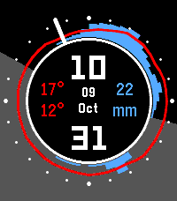
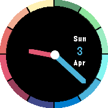

<!-- Generated by scripts/update_app_directory.py: do not edit by hand -->
[← All Pebble Developers](../developers.md)

# 4T2

*2 watchfaces and 1 app · Last updated 2026-10-11 · [About these lists](../about-app-lists.md)*

Links: [Rebble App Store](https://apps.rebble.io/en_US/developer/563f600c8e55a1b90c00004f/1) · [Pebble App Store](https://apps.repebble.com/apps/dev/4t2_563f600c8e55a1b90c00004f) · [GitHub (ofietze)](https://github.com/ofietze)

<button type="button" data-filter="all" aria-pressed="true">All 3</button><button type="button" data-filter="watchface" aria-pressed="false">Watchfaces 2</button><button type="button" data-filter="watchapp" aria-pressed="false">Apps 1</button>

<label class="dev-sort">Sort by <select><option value="updated">Recently updated</option><option value="released">Newest release</option><option value="title">A–Z</option></select></label>

<h2 class="app-name" id="app-6ac9009db3cf770009612198"><a href="https://apps.rebble.io/en_US/application/6ac9009db3cf770009612198">Weather Dial</a> v1.0.0</h2>
<a class="app-source" href="https://github.com/ofietze/weatherDial/tree/main" title="Source code" data-search-exclude>View source</a>

Watchface · <a href="https://forum.rebble.io/t/1415" title="Discuss this app on the Rebble forum" data-search-exclude>Forum thread</a>

Released 2026-10-09 Updated 2026-10-09 Rebble App Store

Runs on: Time 2

Showing you 5 key data points: time, date, temperature, rain, and daylight — the 5-in-1 shampoo of watchfaces. Temperature and precipitation are plotted hour by hour around a 24-hour ring — noon…

<h2 class="app-name" id="app-57016a58cd2a15ffcd000041"><a href="https://apps.repebble.com/57016a58cd2a15ffcd000041">AnalogRainbow</a> v1.3</h2>
<a class="app-source" href="https://github.com/ofietze/analograinbow" title="Source code" data-search-exclude>View source</a>

Watchface · <a href="https://forum.rebble.io/t/1416" title="Discuss this app on the Rebble forum" data-search-exclude>Forum thread</a>

Released 2016-04-03 Updated 2026-10-09

Runs on: Round 2, Time Round

This Watchface is all about Color! The hour and minute hands change their color, depending on which part of the outer ring they are pointing at. Displayed on the right (or left, depending on where…

<h2 class="app-name" id="app-6a14b141c130af00096bf774"><a href="https://apps.rebble.io/en_US/application/6a14b141c130af00096bf774">Scryble - A Magic: The Gathering card viewer</a> v1.0.0</h2>
<a class="app-source" href="https://github.com/ofietze/scryble" title="Source code" data-search-exclude>View source</a>

App · <a href="https://forum.rebble.io/t/998" title="Discuss this app on the Rebble forum" data-search-exclude>Forum thread</a>

Released 2026-05-25 Updated 2026-05-25 Rebble App Store

Runs on: Time 2

A Magic: The Gathering card viewer for Pebble. You don&#x27;t need this. Your phone can look up cards just fine. But when a buddy mentions a card you&#x27;ve never heard of and you want to pull it up — or…

