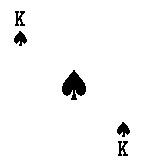
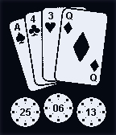
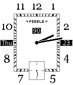
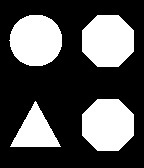

<!-- Generated by scripts/update_app_directory.py: do not edit by hand -->
[← All Pebble Developers](../developers.md)

# 8a22a

*6 watchfaces and 1 app · Last updated 2026-10-11 · [About these lists](../about-app-lists.md)*

Links: [Pebble App Store](https://apps.repebble.com/apps/dev/8a22a_529c6b5bf7997434c1000021) · [GitHub (8a22a)](https://github.com/8a22a)

<button type="button" data-filter="all" aria-pressed="true">All 7</button><button type="button" data-filter="watchface" aria-pressed="false">Watchfaces 6</button><button type="button" data-filter="watchapp" aria-pressed="false">Apps 1</button>

<label class="dev-sort">Sort by <select><option value="updated">Recently updated</option><option value="released">Newest release</option><option value="title">A–Z</option></select></label>

<h2 class="app-name" id="app-53060d84b704cb412c000187"><a href="https://apps.repebble.com/53060d84b704cb412c000187">Trails</a> v2.0.0</h2>
<a class="app-source" href="https://github.com/8a22a/Trails" title="Source code" data-search-exclude>View source</a>

Watchface

No licence Released 2014-02-20 Updated 2014-02-20

Runs on: Time 2, Pebble 2 Duo, Pebble 2, Time, Classic

The time represented by two trails. The wider inner trail is the hour and the thinner outer trail is the minutes. Imagine a circle at the end of the trail to determine the number position.

<h2 class="app-name" id="app-52f16d07e21be486880006c3"><a href="https://apps.repebble.com/52f16d07e21be486880006c3">Deck of Cards</a> v2.0</h2>
<a class="app-source" href="https://github.com/8a22a/DeckofCards" title="Source code" data-search-exclude>View source</a>

App

No licence Released 2014-02-04 Updated 2014-02-04

Runs on: Time 2, Pebble 2 Duo, Pebble 2, Time, Classic

A full deck of cards on your wrist.

<h2 class="app-name" id="app-52e6652aa12c554b9b00001d"><a href="https://apps.repebble.com/52e6652aa12c554b9b00001d">Poker Face</a> v2.0</h2>
<a class="app-source" href="https://github.com/8a22a/PokerFace" title="Source code" data-search-exclude>View source</a>

Watchface

No licence Released 2014-01-27 Updated 2014-01-27

Runs on: Time 2, Pebble 2 Duo, Pebble 2, Time, Classic

The time and date represented by playing cards and poker chips. Time is in 24h format with A=1 and Q=0.

<h2 class="app-name" id="app-52e1250ad8561d30c500023f"><a href="https://apps.repebble.com/52e1250ad8561d30c500023f">Art Deco</a> v2.0.1</h2>
<a class="app-source" href="https://github.com/8a22a/ArtDeco" title="Source code" data-search-exclude>View source</a>

Watchface

No licence Released 2014-01-23 Updated 2014-01-27

Runs on: Time 2, Pebble 2 Duo, Pebble 2, Time, Classic

A beautiful analogue watchface including day, date and battery percentage. Based on artwork by c0u94r.

<h2 class="app-name" id="app-52e0123fdbbbf9518a00015d"><a href="https://apps.repebble.com/52e0123fdbbbf9518a00015d">Shapes</a> v2.0</h2>
<a class="app-source" href="https://github.com/8a22a/Shapes" title="Source code" data-search-exclude>View source</a>

Watchface

No licence Released 2014-01-22 Updated 2014-01-22

Runs on: Time 2, Pebble 2 Duo, Pebble 2, Time, Classic

Big time using shapes. Read the time by counting the number of the shape&#x27;s sides.

<h2 class="app-name" id="app-52dfff6c011368e7f800014b"><a href="https://apps.repebble.com/52dfff6c011368e7f800014b">PCB Binary</a> v2.0</h2>
<a class="app-source" href="https://github.com/8a22a/PCBbinary" title="Source code" data-search-exclude>View source</a>

Watchface

No licence Released 2014-01-22 Updated 2014-01-22

Runs on: Time 2, Pebble 2 Duo, Pebble 2, Time, Classic

Binary watchface with PCB background design.

<h2 class="app-name" id="app-529c6e34f33e76bad4000026"><a href="https://apps.repebble.com/529c6e34f33e76bad4000026">BSL Time</a> v2.0</h2>
<a class="app-source" href="https://github.com/8a22a/BSLtime" title="Source code" data-search-exclude>View source</a>

Watchface

No licence Released 2013-12-02 Updated 2013-12-02

Runs on: Time 2, Pebble 2 Duo, Pebble 2, Time, Classic

The time represented using British Sign Language numbers.

