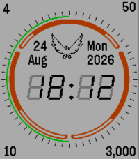

<!-- Generated by scripts/update_app_directory.py: do not edit by hand -->
[← All Pebble Developers](../developers.md)

# a1291762

*1 watchface · Last updated 2026-10-11 · [About these lists](../about-app-lists.md)*

Links: [Pebble App Store](https://apps.repebble.com/apps/dev/a1291762_68f86970856ddb00087e4aad) · [GitHub (a1291762)](https://github.com/a1291762) · [Website (yasmar.net)](https://yasmar.net/)

<h2 class="app-name" id="app-691d860bf5dd2700093ddbbd"><a href="https://apps.repebble.com/691d860bf5dd2700093ddbbd">SHD</a> v2.4</h2>
<a class="app-source" href="https://github.com/a1291762/shd-pebble" title="Source code" data-search-exclude>View source</a>

Watchface · <a href="https://forum.rebble.io/t/573" title="Discuss this app on the Rebble forum" data-search-exclude>Forum thread</a>

No licence Released 2025-11-19 Updated 2026-06-04

Runs on: Round 2, Time 2, Pebble 2 Duo, Pebble 2, Time Round, Time, Classic

A watch face based on the loading animation from Tom Clancy&#x27;s The Division.

