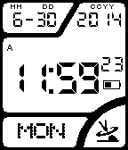

<!-- Generated by scripts/update_app_directory.py: do not edit by hand -->
[← All Pebble Developers](../developers.md)

# Aardvark

*1 watchface · Last updated 2026-10-11 · [About these lists](../about-app-lists.md)*

Links: [Pebble App Store](https://apps.repebble.com/apps/dev/aardvark_53aae71987ed809c5300024d) · [GitHub (Whobeu)](https://github.com/Whobeu)

<h2 class="app-name" id="app-53b1c7d2e22ed5c40d00008a"><a href="https://apps.repebble.com/53b1c7d2e22ed5c40d00008a">Casio WV-58A with AM/PM</a> v1.2</h2>
<a class="app-source" href="https://github.com/Whobeu/WV-58A/archive/master.zip" title="Source code" data-search-exclude>View source</a>

Watchface

No licence Released 2014-06-30 Updated 2014-07-09

Runs on: Time 2, Pebble 2 Duo, Pebble 2, Time, Classic

This is my first attempt at a watch face. It is based upon the source code of Jack T.&#x27;s Casio-WV58DE project. I myself have the Casio WV58A United States version which is slightly different. I…

