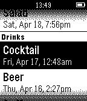

<!-- Generated by scripts/update_app_directory.py: do not edit by hand -->
[← All Pebble Developers](../developers.md)

# Aaron Parecki

*1 app · Last updated 2026-10-11 · [About these lists](../about-app-lists.md)*

Links: [Pebble App Store](https://apps.repebble.com/apps/dev/aaron-parecki_5425f56a6b904023360000c8) · [GitHub (aaronpk)](https://github.com/aaronpk) · [Website (teacup.p3k.io)](https://teacup.p3k.io/pebble)

<h2 class="app-name" id="app-5456c83433c864a87f0000b9"><a href="https://apps.repebble.com/5456c83433c864a87f0000b9">Teacup</a> v1.21</h2>
<a class="app-source" href="https://github.com/aaronpk/Teacup-for-Pebble" title="Source code" data-search-exclude>View source</a>

App

No licence Released 2014-11-03 Updated 2015-04-21

Runs on: Time 2, Pebble 2 Duo, Pebble 2, Time, Classic

Teacup is a simple app for tracking what you eat and drink.

