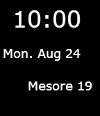

<!-- Generated by scripts/update_app_directory.py: do not edit by hand -->
[← All Pebble Developers](../developers.md)

# Abanoub G

*1 watchface · Last updated 2026-10-12 · [About these lists](../about-app-lists.md)*

Links: [Pebble App Store](https://apps.repebble.com/apps/dev/abanoub-g_542b11719224d4a8ef0001d1) · [GitHub (edwinfinch)](https://github.com/edwinfinch)

<h2 class="app-name" id="app-55dc03f469aa9519ea000070"><a href="https://apps.repebble.com/55dc03f469aa9519ea000070">Coptic Time</a> v2.1</h2>
<a class="app-source" href="https://github.com/edwinfinch/coptic-2" title="Source code" data-search-exclude>View source</a>

Watchface

No licence Released 2015-08-25 Updated 2015-08-25

Runs on: Time 2, Pebble 2 Duo, Pebble 2, Time, Classic

Ever wish that you can look down at your watch and know what the Coptic Date is? Well now you can. Coptic Time displays the Coptic Date alongside the Gregorian date as well as the time.

