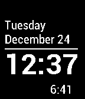

<!-- Generated by scripts/update_app_directory.py: do not edit by hand -->
[← All Pebble Developers](../developers.md)

# abarry

*1 watchface · Last updated 2026-10-12 · [About these lists](../about-app-lists.md)*

Links: [Pebble App Store](https://apps.repebble.com/apps/dev/abarry_52b8a0d95dfb6ebaec000003) · [GitHub (andybarry)](https://github.com/andybarry) · [Website (abarry.org)](http://abarry.org)

<h2 class="app-name" id="app-52b91915fd47639dc6000049"><a href="https://apps.repebble.com/52b91915fd47639dc6000049">Simple + sunrise/set</a> v1.0.3</h2>
<a class="app-source" href="https://github.com/andybarry/simplday" title="Source code" data-search-exclude>View source</a>

Watchface

No licence Released 2013-12-24 Updated 2014-01-10

Runs on: Time 2, Pebble 2 Duo, Pebble 2, Time, Classic

Simple watchface from Bob Hauck modified to show time until next sunrise or sunset based on phone&#x27;s location.

