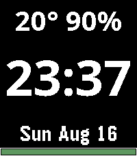

<!-- Generated by scripts/update_app_directory.py: do not edit by hand -->
[← All Pebble Developers](../developers.md)

# abattech

*1 watchface · Last updated 2026-10-12 · [About these lists](../about-app-lists.md)*

Links: [Pebble App Store](https://apps.repebble.com/apps/dev/abattech_74d05b8b52e021861bbaf44d) · [GitHub (abattech)](https://github.com/abattech)

<h2 class="app-name" id="app-d8da649fb37a48a98fa557d1"><a href="https://apps.repebble.com/d8da649fb37a48a98fa557d1">Stone Face</a> v1.0.1</h2>
<a class="app-source" href="https://github.com/abattech/pebble_face1" title="Source code" data-search-exclude>View source</a>

Watchface

No licence Released 2026-08-17 Updated 2026-08-17

Runs on: Round 2, Time 2

A simple watch face with focus on large fonts

