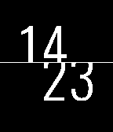

<!-- Generated by scripts/update_app_directory.py: do not edit by hand -->
[← All Pebble Developers](../developers.md)

# Aborgh

*2 watchfaces · Last updated 2026-10-12 · [About these lists](../about-app-lists.md)*

Links: [Pebble App Store](https://apps.repebble.com/apps/dev/aborgh_535e766476f4f69ca60001e4) · [GitHub (Aborgh)](https://github.com/Aborgh)

<button type="button" data-filter="all" aria-pressed="true">All 2</button><button type="button" data-filter="watchface" aria-pressed="false">Watchfaces 2</button><button type="button" data-filter="watchapp" aria-pressed="false" disabled>Apps 0</button>

<label class="dev-sort">Sort by <select><option value="updated">Recently updated</option><option value="released">Newest release</option><option value="title">A–Z</option></select></label>

<h2 class="app-name" id="app-5550a0b7b2255f3187000025"><a href="https://apps.repebble.com/5550a0b7b2255f3187000025">Cutoff</a> v3.01</h2>
<a class="app-source" href="https://github.com/Aborgh/RAM" title="Source code" data-search-exclude>View source</a>

Watchface

No licence Released 2015-05-11 Updated 2025-11-25

Runs on: Time 2, Pebble 2 Duo, Pebble 2, Time, Classic

A watchface that cuts off the lower part of hours and upper part of minutes to create a sleek cutoff effect. This is my first watchface so be nice :) It&#x27;s for both pebble and pebble time. BIG…

<h2 class="app-name" id="app-5550e275095d4f2155000058"><a href="https://apps.repebble.com/5550e275095d4f2155000058">Ram</a> v2.01</h2>
<a class="app-source" href="https://github.com/Aborgh/RAM" title="Source code" data-search-exclude>View source</a>

Watchface

No licence Released 2015-05-11 Updated 2015-06-01

Runs on: Time 2, Pebble 2 Duo, Pebble 2, Time, Classic

One of my two first watchfaces I have ever made. It is suppose to be clean design that is easy to read and nice to look at. :) More configuration coming soon

