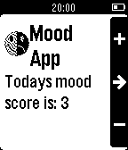

<!-- Generated by scripts/update_app_directory.py: do not edit by hand -->
[← All Pebble Developers](../developers.md)

# Abrega

*1 app · Last updated 2026-10-11 · [About these lists](../about-app-lists.md)*

Links: [Pebble App Store](https://apps.repebble.com/apps/dev/abrega_5539a63fa7c65798c800006a) · [GitHub (bberenberg)](https://github.com/bberenberg) · [Website (abrega.com)](https://abrega.com)

<h2 class="app-name" id="app-55b65b171ad0f4bb56000061"><a href="https://apps.repebble.com/55b65b171ad0f4bb56000061">MoodApp</a> v2.5</h2>
<a class="app-source" href="https://github.com/bberenberg/MoodApp" title="Source code" data-search-exclude>View source</a>

App

No licence Released 2015-07-27 Updated 2016-06-10

Runs on: Round 2, Time 2, Pebble 2 Duo, Pebble 2, Time Round, Time, Classic

Track your mood. Provides reminders and historical graphs. Register an account via the settings to see the analytics.

