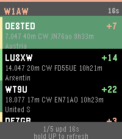
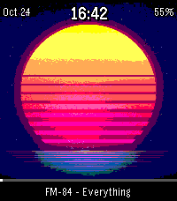
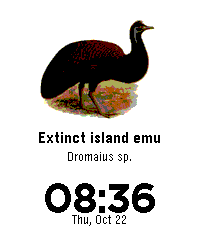
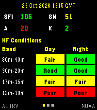
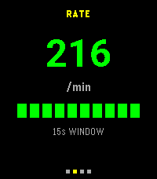
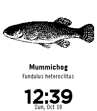

<!-- Generated by scripts/update_app_directory.py: do not edit by hand -->
[← All Pebble Developers](../developers.md)

# AC1RV

*3 watchfaces and 4 apps · Last updated 2026-11-02 · [About these lists](../about-app-lists.md)*

Links: [Pebble App Store](https://apps.repebble.com/apps/dev/ac1rv_6777264aa2b96c9dc917ffe3) · [GitHub (Darachnid)](https://github.com/Darachnid)

<button type="button" data-filter="all" aria-pressed="true">All 7</button><button type="button" data-filter="watchface" aria-pressed="false">Watchfaces 3</button><button type="button" data-filter="watchapp" aria-pressed="false">Apps 4</button>

<label class="dev-sort">Sort by <select><option value="updated">Recently updated</option><option value="released">Newest release</option><option value="title">A–Z</option></select></label>

<h2 class="app-name" id="app-6b3d339514db438588a361ce"><a href="https://apps.repebble.com/6b3d339514db438588a361ce">RBN Spots</a> v1.2.1</h2>
<a class="app-source" href="https://github.com/Darachnid/rbn-spots-pebble" title="Source code" data-search-exclude>View source</a>

App

GPL-3.0 Released 2026-10-24 Updated 2026-10-24

Runs on: Round 2, Time 2

RBN Spots is a ham radio app for checking Reverse Beacon Network spots on your wrist—who heard your callsign, how strong the report was, and where the skimmer is—before or after CW, contesting…

<h2 class="app-name" id="app-0d26f301e1f14b2e98970f62"><a href="https://apps.repebble.com/0d26f301e1f14b2e98970f62">Now Playing Art</a> v1.0.0</h2>
<a class="app-source" href="https://github.com/Darachnid/music-time-free/" title="Source code" data-search-exclude>View source</a>

Watchface

GPL-3.0 Released 2026-10-24 Updated 2026-10-24

Runs on: Time 2

Android only. Now Playing Art is a free, open-source Pebble Time 2 watchface with a small Android companion app. It shows full-screen album art from whatever is playing on your phone, plus time…

<h2 class="app-name" id="app-3a50c8d0d5444f4994cb7105"><a href="https://apps.repebble.com/3a50c8d0d5444f4994cb7105">Extinct Birds (1907)</a> v0.1.1</h2>
<a class="app-source" href="https://github.com/Darachnid/extinct-birds-pebble-watchface" title="Source code" data-search-exclude>View source</a>

Watchface

GPL-3.0 Released 2026-10-22 Updated 2026-10-24

Runs on: Time 2

A watchface featuring a different extinct bird each day, using historical illustrations from Extinct Birds (1907). Each bird is displayed with its common and scientific names. The illustration…

<h2 class="app-name" id="app-c533e3a8ceaf41cc823c6c35"><a href="https://apps.repebble.com/c533e3a8ceaf41cc823c6c35">HF Bands</a> v1.0.0</h2>
<a class="app-source" href="https://github.com/Darachnid/HF-Bands-pebble-watch" title="Source code" data-search-exclude>View source</a>

App

No licence Released 2026-10-23 Updated 2026-10-23

Runs on: Time 2

HF Bands is a ham radio app for checking band conditions and solar data before CW, contesting, POTA, SOTA, ARRL Field Day, or any other operating. Values sit on a black background, with yellow…

<h2 class="app-name" id="app-d05929dec0a64e5e9fcdf2cc"><a href="https://apps.repebble.com/d05929dec0a64e5e9fcdf2cc">DPS Field</a> v1.0.0</h2>
<a class="app-source" href="https://github.com/Darachnid/dps-field" title="Source code" data-search-exclude>View source</a>

App

GPL-3.0 Released 2026-10-23 Updated 2026-10-23

Runs on: Time 2

DPS Field is a Pebble watch companion for the DPS field controller running on the same phone. The watch uses the same dark layout as HF Bands: black background, yellow titles, and white figures…

<h2 class="app-name" id="app-67628db68f614317b7826cb1"><a href="https://apps.repebble.com/67628db68f614317b7826cb1">Fresh Water Fishes of New England (1896)</a> v0.3.3</h2>
<a class="app-source" href="https://github.com/Darachnid/fish-of-new-england-pebble-watchface" title="Source code" data-search-exclude>View source</a>

Watchface

No licence Released 2026-10-18 Updated 2026-10-22

Runs on: Time 2

Fresh Water Fishes of New England (1896) A watchface featuring a different fish each day, using original public-domain illustrations from The Fresh Water Fishes of New England. Each fish is…

<h2 class="app-name" id="app-d6b996961c344d6c8dbc7da4"><a href="https://apps.repebble.com/d6b996961c344d6c8dbc7da4">Morse Bird</a> v0.1.0</h2>
<a class="app-source" href="https://github.com/Darachnid/morse-bird" title="Source code" data-search-exclude>View source</a>

App

GPL-3.0 Released 2026-10-20 Updated 2026-10-20

Runs on: Time 2

Morse Bird A Free and Open Source Morse code keyer for Pebble Time 2 with an animated drinking bird. Morse Bird lets you send and decode Morse code using your Pebble Time 2&#x27;s physical buttons…

