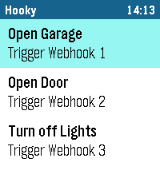

<!-- Generated by scripts/update_app_directory.py: do not edit by hand -->
[← All Pebble Developers](../developers.md)

# Achi

*2 apps · Last updated 2026-10-11 · [About these lists](../about-app-lists.md)*

Links: [Pebble App Store](https://apps.repebble.com/apps/dev/achi_5b39d75c38e0aa0001e8c763) · [GitHub (michi1996)](https://github.com/michi1996)

<button type="button" data-filter="all" aria-pressed="true">All 2</button><button type="button" data-filter="watchface" aria-pressed="false" disabled>Watchfaces 0</button><button type="button" data-filter="watchapp" aria-pressed="false">Apps 2</button>

<label class="dev-sort">Sort by <select><option value="updated">Recently updated</option><option value="released">Newest release</option><option value="title">A–Z</option></select></label>

<h2 class="app-name" id="app-68fa323fa0599b0008f65a07"><a href="https://apps.repebble.com/68fa323fa0599b0008f65a07">Hooky</a> v3.1.0</h2>
<a class="app-source" href="https://github.com/michi1996/pebble-hooky-webhook-trigger" title="Source code" data-search-exclude>View source</a>

App

Released 2025-10-23 Updated 2026-10-04

Runs on: Round 2, Time 2, Pebble 2 Duo, Pebble 2, Time Round, Time, Classic

Hooky lets you trigger webhooks from your Pebble smartwatch with a single tap. Control smart home devices, send notifications or connect your favorite services – simple, fast and reliable. Key…

<h2 class="app-name" id="app-864fb2cb5c0444b088dbbaa0"><a href="https://apps.repebble.com/864fb2cb5c0444b088dbbaa0">Authenticator</a> v2.0.1</h2>
<a class="app-source" href="https://github.com/michi1996/pebble-authenticator" title="Source code" data-search-exclude>View source</a>

App

Released 2026-05-08 Updated 2026-10-04

Runs on: Round 2, Time 2, Pebble 2 Duo, Pebble 2, Time Round, Time, Classic

Pebble Authenticator brings your two-factor authentication (2FA/TOTP) codes directly to your Pebble smartwatch. No need to reach for your phone to unlock your accounts, just glance at your wrist…

