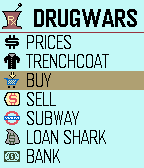

<!-- Generated by scripts/update_app_directory.py: do not edit by hand -->
[← All Pebble Developers](../developers.md)

# AClymer

*1 app · Last updated 2026-10-11 · [About these lists](../about-app-lists.md)*

Links: [Pebble App Store](https://apps.repebble.com/apps/dev/aclymer_52a0cb5f2a0bb9c84700002c) · [GitHub (aclymer)](https://github.com/aclymer) · [Website (forums.getpebble.com)](http://forums.getpebble.com/discussion/20771/watchapp-drug-wars-for-pebble#latest)

<h2 class="app-name" id="app-54d039280782b8e64200005f"><a href="https://apps.repebble.com/54d039280782b8e64200005f">Drug Wars</a> v3.5</h2>
<a class="app-source" href="https://github.com/aclymer/DrugWars" title="Source code" data-search-exclude>View source</a>

App · <a href="https://forum.rebble.io/t/985" title="Discuss this app on the Rebble forum" data-search-exclude>Forum thread</a>

No licence Released 2015-02-03 Updated 2026-05-19

Runs on: Time 2, Pebble 2 Duo, Pebble 2, Time, Classic

The Classic Drug Wars game is now available for Pebble. Originally written for IBM by John E. Dell 1984. (Adapted from TI-84 game code)

