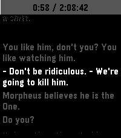
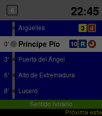

<!-- Generated by scripts/update_app_directory.py: do not edit by hand -->
[← All Pebble Developers](../developers.md)

# acmc

*1 watchface and 1 app · Last updated 2026-10-12 · [About these lists](../about-app-lists.md)*

Links: [Pebble App Store](https://apps.repebble.com/apps/dev/acmc_ad2ff26b86cb890177f9e873) · [GitHub (ACMCMC)](https://github.com/ACMCMC) · [Website (acmc.fyi)](https://acmc.fyi)

<button type="button" data-filter="all" aria-pressed="true">All 2</button><button type="button" data-filter="watchface" aria-pressed="false">Watchfaces 1</button><button type="button" data-filter="watchapp" aria-pressed="false">Apps 1</button>

<label class="dev-sort">Sort by <select><option value="updated">Recently updated</option><option value="released">Newest release</option><option value="title">A–Z</option></select></label>

<h2 class="app-name" id="app-6c7e1da6cbdd4c39b2e7bee7"><a href="https://apps.repebble.com/6c7e1da6cbdd4c39b2e7bee7">Subtitles</a> v1.0.3</h2>
<a class="app-source" href="https://github.com/ACMCMC/pebble-subtitles" title="Source code" data-search-exclude>View source</a>

App · <a href="https://forum.rebble.io/t/1295" title="Discuss this app on the Rebble forum" data-search-exclude>Forum thread</a>

No licence Released 2026-08-29 Updated 2026-08-29

Runs on: Round 2, Time 2, Pebble 2 Duo, Pebble 2, Time Round, Time, Classic

This is an app to see the subtitles of a movie or show on your watch :)

<h2 class="app-name" id="app-e4f1579b2a0946c996eaab4e"><a href="https://apps.repebble.com/e4f1579b2a0946c996eaab4e">Metro Madrid L6</a> v1.0.0</h2>
<a class="app-source" href="https://github.com/ACMCMC/pebble-madrid-metro-watchface" title="Source code" data-search-exclude>View source</a>

Watchface · <a href="https://forum.rebble.io/t/1293" title="Discuss this app on the Rebble forum" data-search-exclude>Forum thread</a>

No licence Released 2026-08-29 Updated 2026-08-29

Runs on: Time 2, Time

&quot;A Line 6 loop an hour... keeps the boredom away&quot;

