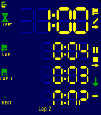
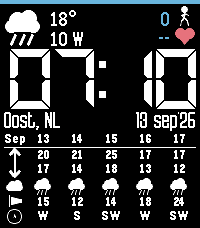

<!-- Generated by scripts/update_app_directory.py: do not edit by hand -->
[← All Pebble Developers](../developers.md)

# ACW Bright

*1 watchface and 2 apps · Last updated 2026-10-11 · [About these lists](../about-app-lists.md)*

Links: [Pebble App Store](https://apps.repebble.com/apps/dev/acw-bright_b9b8c4f23559db00c877cab5) · [GitHub (ArcoW2)](https://github.com/ArcoW2)

<button type="button" data-filter="all" aria-pressed="true">All 3</button><button type="button" data-filter="watchface" aria-pressed="false">Watchfaces 1</button><button type="button" data-filter="watchapp" aria-pressed="false">Apps 2</button>

<label class="dev-sort">Sort by <select><option value="updated">Recently updated</option><option value="released">Newest release</option><option value="title">A–Z</option></select></label>

<h2 class="app-name" id="app-45cf2394b13b49e9b88bd4ba"><a href="https://apps.repebble.com/45cf2394b13b49e9b88bd4ba">Timer / Chrono</a> v1.0.1</h2>
<a class="app-source" href="https://github.com/ArcoW2/Pebble-app-Timer-Chrono" title="Source code" data-search-exclude>View source</a>

App

No licence Released 2026-09-24 Updated 2026-09-24

Runs on: Time 2, Pebble 2 Duo, Pebble 2, Time

Modes ----- Count up, count down for a duration, or count down until a clock time. The three are distinguishable modes, each with its own screen layout, colours and alarms. Flexible layout…

<h2 class="app-name" id="app-2e78cc34b3ea4a61a840b53c"><a href="https://apps.repebble.com/2e78cc34b3ea4a61a840b53c">HA-launch script from shortcut 01</a> v1.0</h2>
<a class="app-source" href="https://github.com/ArcoW2/pebble-app-HA-launch-script-from-shortcut-01" title="Source code" data-search-exclude>View source</a>

App

No licence Released 2026-09-13 Updated 2026-09-13

Runs on: Round 2, Time 2, Pebble 2 Duo, Pebble 2, Time Round, Time, Classic

Launch any Home Assistant script from a physical button of the watch. - Faceless app (just the button-click) - Vibrates after fire Settings from phone: - HA url - Token - script, e.g…

<h2 class="app-name" id="app-0d9749fe636a4d96acf4d37a"><a href="https://apps.repebble.com/0d9749fe636a4d96acf4d37a">ACW BIG time with forecast weather table</a> v1.0.1</h2>
<a class="app-source" href="https://github.com/ArcoW2/Pebble-watchface-BIG-tabled-forecast" title="Source code" data-search-exclude>View source</a>

Watchface

No licence Released 2026-09-13 Updated 2026-09-13

Runs on: Time 2

Big digital time Current weather and activity Full weather forecast table at the bottom

