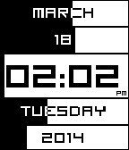
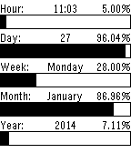
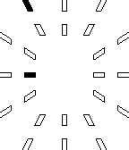

<!-- Generated by scripts/update_app_directory.py: do not edit by hand -->
[← All Pebble Developers](../developers.md)

# acymbalski

*3 watchfaces · Last updated 2026-10-11 · [About these lists](../about-app-lists.md)*

Links: [Pebble App Store](https://apps.repebble.com/apps/dev/acymbalski_52e00e3bf3bd58ee11000154) · [GitHub (acymbalski)](https://github.com/acymbalski)

<button type="button" data-filter="all" aria-pressed="true">All 3</button><button type="button" data-filter="watchface" aria-pressed="false">Watchfaces 3</button><button type="button" data-filter="watchapp" aria-pressed="false" disabled>Apps 0</button>

<label class="dev-sort">Sort by <select><option value="updated">Recently updated</option><option value="released">Newest release</option><option value="title">A–Z</option></select></label>

<h2 class="app-name" id="app-5327544ad92b90517300048f"><a href="https://apps.repebble.com/5327544ad92b90517300048f">Progresssor 2</a> v1.1.1</h2>
<a class="app-source" href="https://github.com/acymbalski/Progressor/tree/revised" title="Source code" data-search-exclude>View source</a>

Watchface

No licence Released 2014-03-17 Updated 2014-03-30

Runs on: Time 2, Pebble 2 Duo, Pebble 2, Time, Classic

A cleaner, more readable version of the original Progressor app. Displays date, month, time, weekday, and year as a progress bar that updates once a minute. New as of 1.1.1: -am/pm indicator now…

<h2 class="app-name" id="app-52e6ddc429970ff37c000044"><a href="https://apps.repebble.com/52e6ddc429970ff37c000044">Progressor</a> v1.1.0</h2>
<a class="app-source" href="https://github.com/acymbalski/Progressor" title="Source code" data-search-exclude>View source</a>

Watchface

No licence Released 2014-01-27 Updated 2014-02-03

Runs on: Time 2, Pebble 2 Duo, Pebble 2, Time, Classic

Displays time as progress bars showing progression through the hour, day, week, month, and year.

<h2 class="app-name" id="app-52e32e282645fb9137001108"><a href="https://apps.repebble.com/52e32e282645fb9137001108">Simplex</a> v1.0.1</h2>
<a class="app-source" href="https://github.com/acymbalski/simplex" title="Source code" data-search-exclude>View source</a>

Watchface

No licence Released 2014-01-25 Updated 2014-01-27

Runs on: Time 2, Pebble 2 Duo, Pebble 2, Time, Classic

A simple watchface that doesn&#x27;t stray from an analog display. Vibrates twice on the hour.

