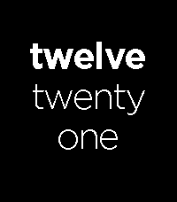

<!-- Generated by scripts/update_app_directory.py: do not edit by hand -->
[← All Pebble Developers](../developers.md)

# Adam Boutcher

*2 watchfaces · Last updated 2026-10-11 · [About these lists](../about-app-lists.md)*

Links: [Pebble App Store](https://apps.repebble.com/apps/dev/adam-boutcher_4109ee557dee33e0ebd84cfe) · [GitHub (adamboutcher)](https://github.com/adamboutcher) · [Website (aboutcher.co.uk)](https://aboutcher.co.uk)

<button type="button" data-filter="all" aria-pressed="true">All 2</button><button type="button" data-filter="watchface" aria-pressed="false">Watchfaces 2</button><button type="button" data-filter="watchapp" aria-pressed="false" disabled>Apps 0</button>

<label class="dev-sort">Sort by <select><option value="updated">Recently updated</option><option value="released">Newest release</option><option value="title">A–Z</option></select></label>

<h2 class="app-name" id="app-30bf2c0381b64d3aaaec0291"><a href="https://apps.repebble.com/30bf2c0381b64d3aaaec0291">Fuzzy Text International 2</a> v2.3.0</h2>
<a class="app-source" href="https://github.com/adamboutcher/Pebble-Fuzzy-Text-International-PT2" title="Source code" data-search-exclude>View source</a>

Watchface

Other Released 2026-05-24 Updated 2026-07-19

Runs on: Round 2, Time 2, Pebble 2 Duo, Pebble 2, Time Round, Time, Classic

Updated version of Fuzzy Text International (supports a number of languages) to support the higher resolution screens of the Duo and PT2. I am not the original developer.

<h2 class="app-name" id="app-02fa247b56814ced8ae0b9ba"><a href="https://apps.repebble.com/02fa247b56814ced8ae0b9ba">Sliding Text International</a> v1.0.1</h2>
<a class="app-source" href="https://github.com/adamboutcher/Pebble-Sliding-Text-International-PT2" title="Source code" data-search-exclude>View source</a>

Watchface

Other Released 2026-06-07 Updated 2026-07-07

Runs on: Round 2, Time 2, Pebble 2 Duo, Pebble 2, Time Round, Time, Classic

A version of the original Pebble Sliding Text watchface that now supports higher resolution PebbleOS devices such as the Pebble Time 2. Unlike the original this watchface supports multiple…

