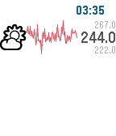

<!-- Generated by scripts/update_app_directory.py: do not edit by hand -->
[← All Pebble Developers](../developers.md)

# Adam Cohen-Rose

*1 app · Last updated 2026-10-12 · [About these lists](../about-app-lists.md)*

Links: [Pebble App Store](https://apps.repebble.com/apps/dev/adam-cohen-rose_52e8f7d4dcc23c69d7000015) · [GitHub (adamcohenrose)](https://github.com/adamcohenrose)

<h2 class="app-name" id="app-5679794d160619693200002b"><a href="https://apps.repebble.com/5679794d160619693200002b">ThingSpark</a> v0.9</h2>
<a class="app-source" href="https://github.com/adamcohenrose/thingspark-pebble" title="Source code" data-search-exclude>View source</a>

App

MIT Released 2015-12-22 Updated 2015-12-23

Runs on: Time 2, Time

A Pebble watch app to display ThingSpeak (https://thingspeak.com/) data as sparklines. Heavily based on xively-pebble (thank you!)

