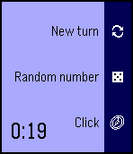
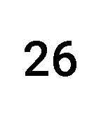

<!-- Generated by scripts/update_app_directory.py: do not edit by hand -->
[← All Pebble Developers](../developers.md)

# adamnfish

*1 watchface and 1 app · Last updated 2026-10-11 · [About these lists](../about-app-lists.md)*

Links: [Pebble App Store](https://apps.repebble.com/apps/dev/adamnfish_531b2719af83c1bfbb000613) · [GitHub (adamnfish)](https://github.com/adamnfish)

<button type="button" data-filter="all" aria-pressed="true">All 2</button><button type="button" data-filter="watchface" aria-pressed="false">Watchfaces 1</button><button type="button" data-filter="watchapp" aria-pressed="false">Apps 1</button>

<label class="dev-sort">Sort by <select><option value="updated">Recently updated</option><option value="released">Newest release</option><option value="title">A–Z</option></select></label>

<h2 class="app-name" id="app-5519ec560f4ab7928f00002d"><a href="https://apps.repebble.com/5519ec560f4ab7928f00002d">PebRunner</a> v0.7</h2>
<a class="app-source" href="https://github.com/adamnfish/PebRunner" title="Source code" data-search-exclude>View source</a>

App

Other Released 2015-03-31 Updated 2016-10-01

Runs on: Round 2, Time 2, Pebble 2 Duo, Pebble 2, Time Round, Time, Classic

PebRunner is an Android: Netrunner assistant for your wrist! It features a click tracker, round timer, and a random number generator to randomise hand access.

<h2 class="app-name" id="app-5519dd51248d68e33700001d"><a href="https://apps.repebble.com/5519dd51248d68e33700001d">Meeting mode</a> v0.2</h2>
<a class="app-source" href="https://github.com/adamnfish/pebble-meeting-mode" title="Source code" data-search-exclude>View source</a>

Watchface

Other Released 2015-03-30 Updated 2015-10-13

Runs on: Time 2, Pebble 2 Duo, Pebble 2, Time, Classic

A Pebble watchface designed for office meetings. Keep track of the time that has passed without having to look at your wrist! Meeting subtly vibrates every 5 minutes and gives a distinctive…

