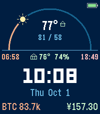

<!-- Generated by scripts/update_app_directory.py: do not edit by hand -->
[← All Pebble Developers](../developers.md)

# AdamShrugged

*1 watchface · Last updated 2026-10-11 · [About these lists](../about-app-lists.md)*

Links: [Pebble App Store](https://apps.repebble.com/apps/dev/adamshrugged_832adb50b6a34a44da7ef143) · [GitHub (Adamshrugged)](https://github.com/Adamshrugged)

<h2 class="app-name" id="app-80720fd9d6e14da5a247adcd"><a href="https://apps.repebble.com/80720fd9d6e14da5a247adcd">Sun Arc</a> v1.0.2</h2>
<a class="app-source" href="https://github.com/Adamshrugged/sun-arc" title="Source code" data-search-exclude>View source</a>

Watchface

MIT Released 2026-10-01 Updated 2026-10-07

Runs on: Time 2

Your day at a glance: the sun travels an arc from sunrise to sunset, and the moon (in its real phase) takes over at night. • Weather: current temperature, today&#x27;s high/low, and a conditions icon…

