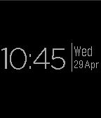

<!-- Generated by scripts/update_app_directory.py: do not edit by hand -->
[← All Pebble Developers](../developers.md)

# Adamxp12.com

*1 watchface · Last updated 2026-10-11 · [About these lists](../about-app-lists.md)*

Links: [Pebble App Store](https://apps.repebble.com/apps/dev/adamxp12-com_5541060ec10fd8287000008e) · [GitHub (adamxp12)](https://github.com/adamxp12) · [Website (adamxp12.com)](http://adamxp12.com)

<h2 class="app-name" id="app-55415124c10fd868f70000bf"><a href="https://apps.repebble.com/55415124c10fd868f70000bf">Adamxp12 Watchface</a> v1.1</h2>
<a class="app-source" href="https://github.com/adamxp12/Adamxp12PebbleFace" title="Source code" data-search-exclude>View source</a>

Watchface

No licence Released 2015-04-29 Updated 2015-04-29

Runs on: Time 2, Pebble 2 Duo, Pebble 2, Time, Classic

A nice and simple watchface

