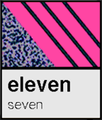

<!-- Generated by scripts/update_app_directory.py: do not edit by hand -->
[← All Pebble Developers](../developers.md)

# AdobeEditor

*1 watchface · Last updated 2026-10-11 · [About these lists](../about-app-lists.md)*

Links: [Pebble App Store](https://apps.repebble.com/apps/dev/adobeeditor_5506524ee1a3a884b90000a3) · [GitHub (AdobeEditor)](https://github.com/AdobeEditor)

<h2 class="app-name" id="app-55edba885aaf6b33cd00002f"><a href="https://apps.repebble.com/55edba885aaf6b33cd00002f">MEMPHIS</a> v2.1</h2>
<a class="app-source" href="https://github.com/AdobeEditor/MEMPHIS" title="Source code" data-search-exclude>View source</a>

Watchface

MIT Released 2015-09-07 Updated 2015-09-22

Runs on: Time 2, Time

Inspired by the Memphis design movement of the 1980&#x27;s, this collection of watchfaces embodies the quirkiness of the antidesign aesthetic.

