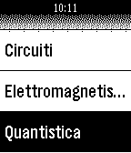

<!-- Generated by scripts/update_app_directory.py: do not edit by hand -->
[← All Pebble Developers](../developers.md)

# Adrenocortico

*1 app · Last updated 2026-10-11 · [About these lists](../about-app-lists.md)*

Links: [Pebble App Store](https://apps.repebble.com/apps/dev/adrenocortico_52b93f2ba1d2dfd76500003f) · [GitHub (Adrenocortico)](https://github.com/Adrenocortico)

<h2 class="app-name" id="app-5305c47421336c693500016a"><a href="https://apps.repebble.com/5305c47421336c693500016a">Formule</a> v1.4</h2>
<a class="app-source" href="https://github.com/Adrenocortico/PebbleFormulas" title="Source code" data-search-exclude>View source</a>

App

Unlicense Released 2014-02-20 Updated 2015-05-27

Runs on: Time 2, Pebble 2 Duo, Pebble 2, Time, Classic

Based on PebbleFormulas it&#x27;s a quick and useful way to access to a many and always new formulas of Algebra, Geometry, Calculus, Trigonometry, Biology, Physics, Chemistry e le Conversion. In…

