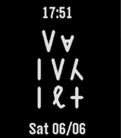

<!-- Generated by scripts/update_app_directory.py: do not edit by hand -->
[← All Pebble Developers](../developers.md)

# Adrian

*1 watchface · Last updated 2026-10-11 · [About these lists](../about-app-lists.md)*

Links: [Pebble App Store](https://apps.repebble.com/apps/dev/adrian_9e41639dad4f43530bce9a4d) · [GitHub (Gibodean)](https://github.com/Gibodean)

<h2 class="app-name" id="app-b7cbeaf2fd86467f976b7ca2"><a href="https://apps.repebble.com/b7cbeaf2fd86467f976b7ca2">EridianTime</a> v1.2</h2>
<a class="app-source" href="https://github.com/Gibodean/EridianTime" title="Source code" data-search-exclude>View source</a>

Watchface

No licence Released 2026-06-07 Updated 2026-06-07

Runs on: Time 2

Amaze! Timekeeping for Eridians Celebrate Andy Weir’s Project Hail Mary with a dynamic watchface that calculates the current time in pure Base-6. How to Read It: Just like Rocky, you decode the…

