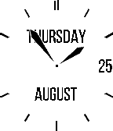

<!-- Generated by scripts/update_app_directory.py: do not edit by hand -->
[← All Pebble Developers](../developers.md)

# AFSpeirs

*2 watchfaces · Last updated 2026-10-11 · [About these lists](../about-app-lists.md)*

Links: [Pebble App Store](https://apps.repebble.com/apps/dev/afspeirs_54ecb62899a35db1e50000a2) · [GitHub (afspeirs)](https://github.com/afspeirs)

<button type="button" data-filter="all" aria-pressed="true">All 2</button><button type="button" data-filter="watchface" aria-pressed="false">Watchfaces 2</button><button type="button" data-filter="watchapp" aria-pressed="false" disabled>Apps 0</button>

<label class="dev-sort">Sort by <select><option value="updated">Recently updated</option><option value="released">Newest release</option><option value="title">A–Z</option></select></label>

<h2 class="app-name" id="app-56f3e4233ae8cc8e3400003e"><a href="https://apps.repebble.com/56f3e4233ae8cc8e3400003e">Simply Digital</a> v0.71</h2>
<a class="app-source" href="https://github.com/afspeirs/SimplyDigital" title="Source code" data-search-exclude>View source</a>

Watchface · <a href="https://forum.rebble.io/t/1093" title="Discuss this app on the Rebble forum" data-search-exclude>Forum thread</a>

MIT Released 2016-03-24 Updated 2026-06-27

Runs on: Round 2, Time 2, Pebble 2 Duo, Pebble 2, Time Round, Time, Classic

A simple digital watchface. Designed to not be overly complex and give you access to the information you need (time and date). Features: • Bluetooth disconnection alert - Will notify you when you…

<h2 class="app-name" id="app-57b82c80bb85ed9aa5000943"><a href="https://apps.repebble.com/57b82c80bb85ed9aa5000943">Simply Analog</a> v0.12</h2>
<a class="app-source" href="https://github.com/afspeirs/SimplyAnalog" title="Source code" data-search-exclude>View source</a>

Watchface

MIT Released 2016-08-20 Updated 2017-06-12

Runs on: Time 2, Pebble 2 Duo, Pebble 2, Time, Classic

A simple analog watchface Designed to not be overly complex and give you access to the information you need (time and date).

