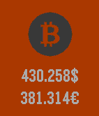

<!-- Generated by scripts/update_app_directory.py: do not edit by hand -->
[← All Pebble Developers](../developers.md)

# Ahmed-Ayed

*1 app · Last updated 2026-10-12 · [About these lists](../about-app-lists.md)*

Links: [Pebble App Store](https://apps.repebble.com/apps/dev/ahmed-ayed_563cb167c8f6b1fe0e000049) · [Website (ahmedayed.com)](http://www.ahmedayed.com/)

<h2 class="app-name" id="app-5712509e9fa1373237000004"><a href="https://apps.repebble.com/5712509e9fa1373237000004">BitcoinToday</a> v2.0</h2>
<a class="app-source" href="http://www.coindesk.com/" title="Source code" data-search-exclude>View source</a>

App

Released 2016-04-16 Updated 2016-04-16

Runs on: Round 2, Time 2, Time Round, Time

BitcoinToday displays and monitors the current BTC exchange rates. You can set custom refresh interval and display USD and EURO rates.

