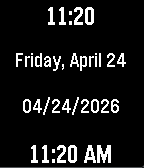

<!-- Generated by scripts/update_app_directory.py: do not edit by hand -->
[← All Pebble Developers](../developers.md)

# Aidan LeMay

*1 app · Last updated 2026-10-11 · [About these lists](../about-app-lists.md)*

Links: [Pebble App Store](https://apps.repebble.com/apps/dev/aidan-lemay_b14b6a375dde09cdbf37ff76) · [GitHub (aidan-lemay)](https://github.com/aidan-lemay)

<h2 class="app-name" id="app-9a929d7de6fd48b992086331"><a href="https://apps.repebble.com/9a929d7de6fd48b992086331">emstime</a> v2.5</h2>
<a class="app-source" href="https://github.com/aidan-lemay/emstime" title="Source code" data-search-exclude>View source</a>

App

No licence Released 2026-04-24 Updated 2026-09-29

Runs on: Round 2, Time 2, Pebble 2 Duo, Pebble 2, Time Round, Time, Classic

Rapid-reference time and date dashboard for EMS. Track 12h/24h time and critical date metrics instantly at a glance

