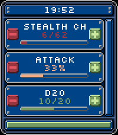

<!-- Generated by scripts/update_app_directory.py: do not edit by hand -->
[← All Pebble Developers](../developers.md)

# AintMina

*1 app · Last updated 2026-10-11 · [About these lists](../about-app-lists.md)*

Links: [Pebble App Store](https://apps.repebble.com/apps/dev/aintmina_d314315373304de9dd1236a5)

<h2 class="app-name" id="app-4f1bca0b807d40b3bb0243cb"><a href="https://apps.repebble.com/4f1bca0b807d40b3bb0243cb">Percentage</a> v1.1</h2>
<a class="app-source" href="https://git.aintmina.org/aintgit/percentage" title="Source code" data-search-exclude>View source</a>

App

Released 2026-09-05 Updated 2026-09-19

Runs on: Time 2

Do you want to keep track of success/fail rates of 24 items? This app lets you configure up to 24 items with phone and update the success/fail values via the touchscreen buttons. It shows you the…

