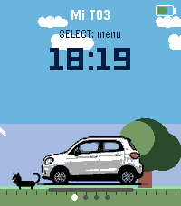

<!-- Generated by scripts/update_app_directory.py: do not edit by hand -->
[← All Pebble Developers](../developers.md)

# aioras

*2 apps · Last updated 2026-10-11 · [About these lists](../about-app-lists.md)*

Links: [Pebble App Store](https://apps.repebble.com/apps/dev/aioras_54571268d6497ea29175596e) · [GitHub (aiorass)](https://github.com/aiorass)

<button type="button" data-filter="all" aria-pressed="true">All 2</button><button type="button" data-filter="watchface" aria-pressed="false" disabled>Watchfaces 0</button><button type="button" data-filter="watchapp" aria-pressed="false">Apps 2</button>

<label class="dev-sort">Sort by <select><option value="updated">Recently updated</option><option value="released">Newest release</option><option value="title">A–Z</option></select></label>

<h2 class="app-name" id="app-23b7e4023deb47b2b30b8a40"><a href="https://apps.repebble.com/23b7e4023deb47b2b30b8a40">Mi T03</a> v1.5.0</h2>
<a class="app-source" href="https://github.com/aiorass/t03-pebble" title="Source code" data-search-exclude>View source</a>

App

No licence Released 2026-08-26 Updated 2026-08-29

Runs on: Round 2, Time 2, Pebble 2 Duo, Pebble 2, Time Round, Time, Classic

Mi T03 connects your Pebble watch to your Leapmotor T03 through Home Assistant (leapmotor-ha integration) — no custom servers or MQTT bridges needed. From your wrist you can: - Check battery…

<h2 class="app-name" id="app-31ab75460ad64fccb3f36b13"><a href="https://apps.repebble.com/31ab75460ad64fccb3f36b13">Bring!</a> v1.1.0</h2>
<a class="app-source" href="https://github.com/aiorass/bring_pebble" title="Source code" data-search-exclude>View source</a>

App

MIT Released 2026-08-26 Updated 2026-08-26

Runs on: Round 2, Time 2, Pebble 2 Duo, Pebble 2, Time Round, Time, Classic

Sync your Bring! shopping list directly to your Pebble. Now with touch control! View pending items on your list, featuring category-specific icons (bread, dairy, fruits, vegetables, meat…

