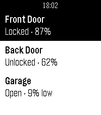

<!-- Generated by scripts/update_app_directory.py: do not edit by hand -->
[← All Pebble Developers](../developers.md)

# AIR

*1 app · Last updated 2026-10-11 · [About these lists](../about-app-lists.md)*

Links: [Pebble App Store](https://apps.repebble.com/apps/dev/air_4ff4b2daac1e10c4993c91f8) · [GitHub (PkAIR)](https://github.com/PkAIR)

<h2 class="app-name" id="app-8f87be4ef19641069bd66359"><a href="https://apps.repebble.com/8f87be4ef19641069bd66359">Wrist Key</a> v0.4.0</h2>
<a class="app-source" href="https://github.com/PkAIR/wrist-key" title="Source code" data-search-exclude>View source</a>

App · <a href="https://forum.rebble.io/t/1116" title="Discuss this app on the Rebble forum" data-search-exclude>Forum thread</a>

MIT Released 2026-07-03 Updated 2026-08-15

Runs on: Round 2, Time 2, Pebble 2 Duo, Pebble 2, Time Round, Time, Classic

Control your WiFi-enabled Nuki Smart Lock straight from your Pebble watch. List your locks and open, unlock or lock the door without reaching for your phone.

