<!-- Generated by scripts/update_app_directory.py: do not edit by hand -->
[← All Pebble Developers](../developers.md)

# AirCodum

*21 watchfaces and 4 apps · Last updated 2026-10-12 · [About these lists](../about-app-lists.md)*

Links: [Pebble App Store](https://apps.repebble.com/apps/dev/aircodum_67bc77bf37d408000a74f7d3) · [GitHub (coredevices)](https://github.com/coredevices) · [GitHub (priyankark)](https://github.com/priyankark) · [Website (priyankar.me)](https://www.priyankar.me/)

<button type="button" data-filter="all" aria-pressed="true">All 25</button><button type="button" data-filter="watchface" aria-pressed="false">Watchfaces 21</button><button type="button" data-filter="watchapp" aria-pressed="false">Apps 4</button>

<label class="dev-sort">Sort by <select><option value="updated">Recently updated</option><option value="released">Newest release</option><option value="title">A–Z</option></select></label>

<h2 class="app-name" id="app-66469b18edac433e82715659"><a href="https://apps.repebble.com/66469b18edac433e82715659">Lake Sammamish</a> v1.0.0</h2>
<a class="app-source" href="https://github.com/coredevices/pebble-watchface-agent-skill" title="Source code" data-search-exclude>View source</a>

Watchface

No licence Released 2026-07-12 Updated 2026-07-12

Runs on: Time 2

A living Lake Sammamish scene that changes with the time of day — dawn, midday, golden sunset, and a starry moonlit night. The sun and moon arc across the sky, the forested Issaquah-Alps foothills…

<a class="app-shot" href="https://apps.repebble.com/9657a1fd4a6c46119e295779" data-search-exclude>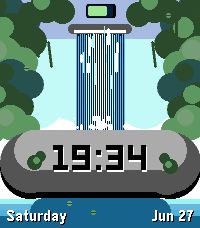</a>

<h2 class="app-name" id="app-9657a1fd4a6c46119e295779"><a href="https://apps.repebble.com/9657a1fd4a6c46119e295779">Serene Waterfall</a> v1.0.0</h2>
<a class="app-source" href="https://github.com/coredevices/pebble-watchface-agent-skill" title="Source code" data-search-exclude>View source</a>

Watchface

No licence Released 2026-06-27 Updated 2026-06-27

Runs on: Time 2

A serene animated waterfall cascades through lush jungle and breaks over a mossy boulder with the time carved into it. Shows the day, date and battery, with continuously flowing water, drifting…

<a class="app-shot" href="https://apps.repebble.com/16369ce3ed5248e696f698fa" data-search-exclude>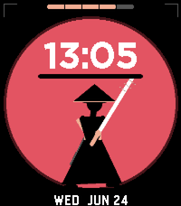</a>

<h2 class="app-name" id="app-16369ce3ed5248e696f698fa"><a href="https://apps.repebble.com/16369ce3ed5248e696f698fa">Ronin Kata</a> v1.0.0</h2>
<a class="app-source" href="https://github.com/coredevices/pebble-watchface-agent-skill" title="Source code" data-search-exclude>View source</a>

Watchface

No licence Released 2026-06-24 Updated 2026-06-24

Runs on: Time 2

A straw-hatted ronin stands before a rising sun. Shake your wrist to unleash a martial-arts kata of single- and dual-sword (nito-ryu) strikes drawn from his hip scabbard, then he freezes in a…

<h2 class="app-name" id="app-73d2d5a2cc2c4a7e90cf1090"><a href="https://apps.repebble.com/73d2d5a2cc2c4a7e90cf1090">Meme Stream</a> v1.0.0</h2>
<a class="app-source" href="https://github.com/coredevices/pebble-watchface-agent-skill" title="Source code" data-search-exclude>View source</a>

App

No licence Released 2026-06-21 Updated 2026-06-21

Runs on: Time 2

Meme Stream shows random captioned memes pulled live from Reddit&#x27;s popular meme communities via the public meme-api.com service. Press any button for the next meme. All content is sourced from…

<h2 class="app-name" id="app-9766eeb388bd47fe8d57729e"><a href="https://apps.repebble.com/9766eeb388bd47fe8d57729e">Toucan Perch</a> v1.0.0</h2>
<a class="app-source" href="https://github.com/coredevices/pebble-watchface-agent-skill" title="Source code" data-search-exclude>View source</a>

Watchface

No licence Released 2026-06-13 Updated 2026-06-13

Runs on: Time 2

A cheerful toucan perched on a jungle branch. The sky follows the time of day: bright and sunny by day, a deep starry night with a crescent moon after dark. The toucan gently bobs, blinks, and…

<a class="app-shot" href="https://apps.repebble.com/b408391bb1c44f589b5297ec" data-search-exclude>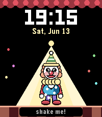</a>

<h2 class="app-name" id="app-b408391bb1c44f589b5297ec"><a href="https://apps.repebble.com/b408391bb1c44f589b5297ec">Circus Clown</a> v1.0.0</h2>
<a class="app-source" href="https://github.com/coredevices/pebble-watchface-agent-skill" title="Source code" data-search-exclude>View source</a>

Watchface

No licence Released 2026-06-13 Updated 2026-06-13

Runs on: Time 2

Shake your wrist and a cheerful circus clown springs to life - juggling, balancing a spinning plate, and back-flipping under the big-top spotlight. When idle it&#x27;s a clean, readable watchface with…

<a class="app-shot" href="https://apps.repebble.com/ca091b35fa40489e82b498c2" data-search-exclude>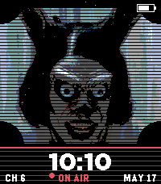</a>

<h2 class="app-name" id="app-ca091b35fa40489e82b498c2"><a href="https://apps.repebble.com/ca091b35fa40489e82b498c2">Hokum Fan Art</a> v1.0.1</h2>
<a class="app-source" href="https://github.com/coredevices/pebble-watchface-agent-skill" title="Source code" data-search-exclude>View source</a>

Watchface

No licence Released 2026-05-17 Updated 2026-05-17

Runs on: Time 2

Vintage horror watchface — a creepy TV station ID with a sinister donkey mascot host, CRT scanlines, and ON AIR badge. Fan art inspired by the 2026 folk-horror film Hokum.

<a class="app-shot" href="https://apps.repebble.com/64c1c12d7fe74e6bba6f7f94" data-search-exclude>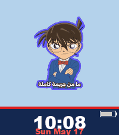</a>

<h2 class="app-name" id="app-64c1c12d7fe74e6bba6f7f94"><a href="https://apps.repebble.com/64c1c12d7fe74e6bba6f7f94">Conan</a> v1.0.1</h2>
<a class="app-source" href="https://github.com/coredevices/pebble-watchface-agent-skill" title="Source code" data-search-exclude>View source</a>

Watchface

No licence Released 2026-05-17 Updated 2026-05-17

Runs on: Time 2

Detective Conan watchface. Cycles 12 detective scenes — one every minute, tap for random. Battery indicator included.

<h2 class="app-name" id="app-b6d8a42ffe164d959c661501"><a href="https://apps.repebble.com/b6d8a42ffe164d959c661501">Shinchan</a> v1.2.4</h2>
<a class="app-source" href="https://github.com/coredevices/pebble-watchface-agent-skill" title="Source code" data-search-exclude>View source</a>

Watchface

No licence Released 2026-05-16 Updated 2026-05-16

Runs on: Time 2

Cartoon kid funny faces watchface. Cycles through 12 silly expressions — one new face every minute. Tap for a random face. Battery indicator in the bottom bar.

<h2 class="app-name" id="app-b626e39712aa46adb6d09fe1"><a href="https://apps.repebble.com/b626e39712aa46adb6d09fe1">XKCD Reader</a> v1.0.3</h2>
<a class="app-source" href="https://github.com/priyankark/xkcd-reader-pebble" title="Source code" data-search-exclude>View source</a>

App · <a href="https://forum.rebble.io/t/892" title="Discuss this app on the Rebble forum" data-search-exclude>Forum thread</a>

Released 2026-04-17 Updated 2026-04-18

Runs on: Round 2, Time 2, Pebble 2 Duo, Pebble 2, Time Round, Time, Classic

Interactive XKCD comic reader. Controls: SELECT loads a random comic. UP/DOWN scrolls the comic manually. Long-press SELECT or shake the watch to reveal the alt-text caption. BACK exits.

<h2 class="app-name" id="app-b68b8fba9a664893a9d16a25"><a href="https://apps.repebble.com/b68b8fba9a664893a9d16a25">XKCD Daily</a> v1.0.1</h2>
<a class="app-source" href="https://github.com/coredevices/pebble-watchface-agent-skill" title="Source code" data-search-exclude>View source</a>

Watchface

No licence Released 2026-04-17 Updated 2026-04-17

Runs on: Time 2

The current XKCD comic, refreshed hourly. Shake your watch to reveal the alt-text caption - the hover-text joke behind each comic.

<a class="app-shot" href="https://apps.repebble.com/560a0f4be93d44fc8d7b42ff" data-search-exclude>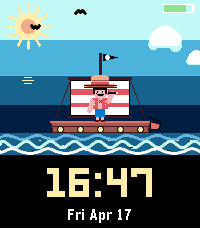</a>

<h2 class="app-name" id="app-560a0f4be93d44fc8d7b42ff"><a href="https://apps.repebble.com/560a0f4be93d44fc8d7b42ff">Voyage</a> v1.1.2</h2>
<a class="app-source" href="https://github.com/coredevices/pebble-watchface-agent-skill" title="Source code" data-search-exclude>View source</a>

Watchface

No licence Released 2026-04-17 Updated 2026-04-17

Runs on: Time 2

Set sail on an animated pirate voyage — a ship bobs on the waves with a captain in his iconic straw hat. Shows time, date, and battery.

<h2 class="app-name" id="app-52ce401057174411a5200265"><a href="https://apps.repebble.com/52ce401057174411a5200265">Ninja Strike</a> v1.0.0</h2>
<a class="app-source" href="https://github.com/coredevices/pebble-watchface-agent-skill" title="Source code" data-search-exclude>View source</a>

Watchface

No licence Released 2026-04-17 Updated 2026-04-17

Runs on: Time 2

A fruit-ninja style watchface. Every minute a ninja dashes across the time, katana trailing neon, slicing it in half before the pieces snap back together. Five different slash patterns …

<h2 class="app-name" id="app-fe6b9da4d64249fd800c779c"><a href="https://apps.repebble.com/fe6b9da4d64249fd800c779c">Langdon</a> v1.1.2</h2>
<a class="app-source" href="https://github.com/coredevices/pebble-watchface-agent-skill" title="Source code" data-search-exclude>View source</a>

Watchface

No licence Released 2026-04-15 Updated 2026-04-16

Runs on: Round 2, Time 2, Time Round

▎ A classic Mickey Mouse analog watchface inspired by Professor Robert Langdon ▎ — the Harvard symbologist from Dan Brown&#x27;s bestselling novels The Da Vinci ▎ Code, Angels &amp; Demons, Inferno, The…

<a class="app-shot" href="https://apps.repebble.com/e7b34d918dc643d1b3d0db37" data-search-exclude>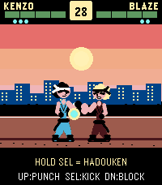</a>

<h2 class="app-name" id="app-e7b34d918dc643d1b3d0db37"><a href="https://apps.repebble.com/e7b34d918dc643d1b3d0db37">Dragon Fist</a> v1.0.0</h2>
<a class="app-source" href="https://github.com/coredevices/pebble-watchface-agent-skill" title="Source code" data-search-exclude>View source</a>

App

No licence Released 2026-04-15 Updated 2026-04-15

Runs on: Time 2

Arcade fighter for Pebble Time 2. KENZO vs BLAZE in endless mode — punch, kick, block, and unleash 3 Dragon Blaze chi blasts per round. Survive as many rounds as you can. Share with #pebbledragonfist

<a class="app-shot" href="https://apps.repebble.com/625a9f4780fa4c5aadee223f" data-search-exclude>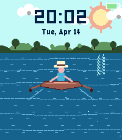</a>

<h2 class="app-name" id="app-625a9f4780fa4c5aadee223f"><a href="https://apps.repebble.com/625a9f4780fa4c5aadee223f">Serene Boater</a> v1.4.0</h2>
<a class="app-source" href="https://github.com/coredevices/pebble-watchface-agent-skill" title="Source code" data-search-exclude>View source</a>

Watchface

No licence Released 2026-04-14 Updated 2026-04-14

Runs on: Time 2

A serene watchface featuring a boater with a straw hat rowing calmly on open water. Distant hills and trees on the horizon, shimmering water with ripples, drifting clouds, and two dolphins that…

<a class="app-shot" href="https://apps.repebble.com/bd6e3f6122b449188e8faebc" data-search-exclude>No screenshot</a>

<h2 class="app-name" id="app-bd6e3f6122b449188e8faebc"><a href="https://apps.repebble.com/bd6e3f6122b449188e8faebc">Flappy Pebble</a> v1.0.1</h2>
<a class="app-source" href="https://github.com/coredevices/pebble-watchface-agent-skill" title="Source code" data-search-exclude>View source</a>

App

No licence Released 2026-04-14 Updated 2026-04-14

Runs on: Time 2

Flappy Bird for your Pebble. Tap SELECT (or hold it) to flap through pipes. Gentle physics tuned for small-screen play, persistent high score.

<a class="app-shot" href="https://apps.repebble.com/7865e440b1bc45749db1b0e9" data-search-exclude>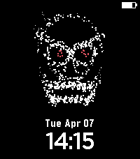</a>

<h2 class="app-name" id="app-7865e440b1bc45749db1b0e9"><a href="https://apps.repebble.com/7865e440b1bc45749db1b0e9">Memento Mori</a> v1.0.2</h2>
<a class="app-source" href="https://github.com/priyankark/pebble-wf-agent-skill" title="Source code" data-search-exclude>View source</a>

Watchface

Released 2026-04-07 Updated 2026-04-07

Runs on: Round 2, Time 2, Pebble 2 Duo, Pebble 2, Time Round, Time, Classic

A particle-dust skull with glowing red eyes that watches over your wrist.

<a class="app-shot" href="https://apps.repebble.com/77027484591b482ba8922068" data-search-exclude>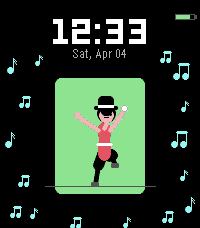</a>

<h2 class="app-name" id="app-77027484591b482ba8922068"><a href="https://apps.repebble.com/77027484591b482ba8922068">Movers and Shakers</a> v1.2.0</h2>
<a class="app-source" href="https://github.com/coredevices/pebble-watchface-agent-skill" title="Source code" data-search-exclude>View source</a>

Watchface

No licence Released 2026-04-04 Updated 2026-04-04

Runs on: Round 2, Time 2, Pebble 2 Duo, Pebble 2, Time Round, Time, Classic

Dancers on your wrist! Shake to trigger 12 cultural dances from around the world — Irish Tap, Bharatanatyam, Flamenco, Hula, Ballet, Samba, Cossack, Breakdance, Capoeira, Bhangra, Michael Jackson…

<h2 class="app-name" id="app-696cecb7fd11fd00098d82f8"><a href="https://apps.repebble.com/696cecb7fd11fd00098d82f8">The Bat</a> v1.0</h2>
<a class="app-source" href="https://github.com/priyankark/pebble-wf-agent-skill" title="Source code" data-search-exclude>View source</a>

Watchface · <a href="https://forum.rebble.io/t/520" title="Discuss this app on the Rebble forum" data-search-exclude>Forum thread</a>

Released 2026-01-18 Updated 2026-01-18

Runs on: Round 2, Time 2, Pebble 2 Duo, Pebble 2, Time Round, Time, Classic

Transform your Pebble into the iconic Bat Signal! Watch as the searchlight sweeps across Gotham&#x27;s night sky, illuminating the legendary bat symbol with a dramatic glow.

<a class="app-shot" href="https://apps.repebble.com/696bde8afd11fd00098d82e8" data-search-exclude>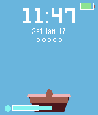</a>

<h2 class="app-name" id="app-696bde8afd11fd00098d82e8"><a href="https://apps.repebble.com/696bde8afd11fd00098d82e8">Pocket Garden</a> v1.0</h2>
<a class="app-source" href="https://github.com/priyankark/pebble-wf-agent-skill" title="Source code" data-search-exclude>View source</a>

Watchface

Released 2026-01-17 Updated 2026-01-17

Runs on: Round 2, Time 2, Pebble 2 Duo, Pebble 2, Time Round, Time, Classic

Grow a virtual plant on your wrist - with wrist exercises! Pocket Garden is an interactive watchface where you nurture a virtual plant throughout the day. Your plant grows from a tiny seed to a…

<a class="app-shot" href="https://apps.repebble.com/67fbabbd8b96250009ecfabe" data-search-exclude>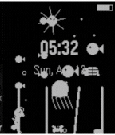</a>

<h2 class="app-name" id="app-67fbabbd8b96250009ecfabe"><a href="https://apps.repebble.com/67fbabbd8b96250009ecfabe">Aqua (Animated)</a> v6.0</h2>
<a class="app-source" href="https://github.com/priyankark/aqua-pbw" title="Source code" data-search-exclude>View source</a>

Watchface

Released 2025-04-13 Updated 2025-04-14

Runs on: Round 2, Time 2, Pebble 2 Duo, Pebble 2, Time Round, Time, Classic

A live aquarium on your wrist!

<a class="app-shot" href="https://apps.repebble.com/67c5bd94b7a02300092ba0aa" data-search-exclude>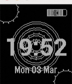</a>

<h2 class="app-name" id="app-67c5bd94b7a02300092ba0aa"><a href="https://apps.repebble.com/67c5bd94b7a02300092ba0aa">Gears of Time (Animated)</a> v1.0</h2>
<a class="app-source" href="https://github.com/priyankark/gears-of-time-pbw" title="Source code" data-search-exclude>View source</a>

Watchface

Released 2025-03-03 Updated 2025-03-03

Runs on: Round 2, Time 2, Pebble 2 Duo, Pebble 2, Time Round, Time, Classic

A clean and elegant watchface featuring smooth rotating spiral animations. Displays time, date, and battery level with a unique spiral theme, creating an engaging visual experience while…

<a class="app-shot" href="https://apps.repebble.com/67c3d858d2acb30009a3c7cf" data-search-exclude>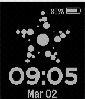</a>

<h2 class="app-name" id="app-67c3d858d2acb30009a3c7cf"><a href="https://apps.repebble.com/67c3d858d2acb30009a3c7cf">Pebble Particles (Animated)</a> v1.0</h2>
<a class="app-source" href="https://github.com/priyankark/pebble-particles-pbw" title="Source code" data-search-exclude>View source</a>

Watchface

Released 2025-03-02 Updated 2025-03-02

Runs on: Round 2, Time 2, Pebble 2 Duo, Pebble 2, Time Round, Time, Classic

Experience time in a mesmerizing new way with Pebble Particles! This elegant watchface transforms your Pebble into a dynamic particle system where time flows through beautiful animated particles…

<h2 class="app-name" id="app-67bd32a7691e55000aa48cde"><a href="https://apps.repebble.com/67bd32a7691e55000aa48cde">Player 456</a> v1.0</h2>
<a class="app-source" href="https://github.com/priyankark/squidgames-pbw-1" title="Source code" data-search-exclude>View source</a>

Watchface

Released 2025-02-25 Updated 2025-02-25

Runs on: Time 2, Pebble 2 Duo, Pebble 2, Time, Classic

Transform your Pebble into an iconic Squid Game guard with this striking watchface. Featuring the distinctive guard mask with its signature white triangle symbol, this watchface brings the intense…

