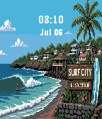

<!-- Generated by scripts/update_app_directory.py: do not edit by hand -->
[← All Pebble Developers](../developers.md)

# AirDroidz

*2 watchfaces · Last updated 2026-10-12 · [About these lists](../about-app-lists.md)*

Links: [Pebble App Store](https://apps.repebble.com/apps/dev/airdroidz_ab3948b10f35feb606d84146) · [GitHub (Airdroidz)](https://github.com/Airdroidz)

<button type="button" data-filter="all" aria-pressed="true">All 2</button><button type="button" data-filter="watchface" aria-pressed="false">Watchfaces 2</button><button type="button" data-filter="watchapp" aria-pressed="false" disabled>Apps 0</button>

<label class="dev-sort">Sort by <select><option value="updated">Recently updated</option><option value="released">Newest release</option><option value="title">A–Z</option></select></label>

<h2 class="app-name" id="app-eee4716c565f45fe9fb6a39e"><a href="https://apps.repebble.com/eee4716c565f45fe9fb6a39e">Retro Centro</a> v1.0</h2>
<a class="app-source" href="https://github.com/Airdroidz/Retro-Centro" title="Source code" data-search-exclude>View source</a>

Watchface

No licence Released 2026-07-19 Updated 2026-07-19

Runs on: Time 2, Time

Take a stroll through the Historic Center of San Salvador every time you check the time. Retro Centro captures the beauty of El Salvador&#x27;s architectural heritage in vibrant pixel art, blending…

<h2 class="app-name" id="app-189ed6b6111c4ceb8014b7e1"><a href="https://apps.repebble.com/189ed6b6111c4ceb8014b7e1">Surf City Watch &#x27;26</a> v1.0.0</h2>
<a class="app-source" href="https://github.com/Airdroidz/Surfcitytime" title="Source code" data-search-exclude>View source</a>

Watchface · <a href="https://forum.rebble.io/t/1128" title="Discuss this app on the Rebble forum" data-search-exclude>Forum thread</a>

No licence Released 2026-07-06 Updated 2026-07-06

Runs on: Time 2, Time

Bring the vibrant coastal energy and world-class waves of El Salvador straight to your wrist! Surf City &#x27;26 is a custom retro pixel-art watchface designed specifically for the Pebble Time. It…

