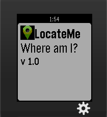

<!-- Generated by scripts/update_app_directory.py: do not edit by hand -->
[← All Pebble Developers](../developers.md)

# Ajin

*1 app · Last updated 2026-10-12 · [About these lists](../about-app-lists.md)*

Links: [Pebble App Store](https://apps.repebble.com/apps/dev/ajin_5565f30e3986100a91000081) · [GitHub (ajinabraham)](https://github.com/ajinabraham) · [Website (opensecurity.in)](http://opensecurity.in)

<h2 class="app-name" id="app-556625566ad39158ce00009d"><a href="https://apps.repebble.com/556625566ad39158ce00009d">LocateMe</a> v1.0</h2>
<a class="app-source" href="https://github.com/ajinabraham/PebbleWatch-LocateMe" title="Source code" data-search-exclude>View source</a>

App

No licence Released 2015-05-27 Updated 2015-05-27

Runs on: Time 2, Pebble 2 Duo, Pebble 2, Time, Classic

LocateMe is a watch app that tells your location.

