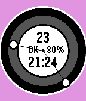
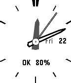
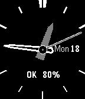

<!-- Generated by scripts/update_app_directory.py: do not edit by hand -->
[← All Pebble Developers](../developers.md)

# Akemori Oda

*3 watchfaces · Last updated 2026-10-12 · [About these lists](../about-app-lists.md)*

Links: [Pebble App Store](https://apps.repebble.com/apps/dev/akemori-oda_56c1c9c5919c5acb8c000002) · [GitHub (bake-san)](https://github.com/bake-san) · [Website (bake-san.blogspot.jp)](http://bake-san.blogspot.jp/)

<button type="button" data-filter="all" aria-pressed="true">All 3</button><button type="button" data-filter="watchface" aria-pressed="false">Watchfaces 3</button><button type="button" data-filter="watchapp" aria-pressed="false" disabled>Apps 0</button>

<label class="dev-sort">Sort by <select><option value="updated">Recently updated</option><option value="released">Newest release</option><option value="title">A–Z</option></select></label>

<h2 class="app-name" id="app-56ed6b537e080dac26000006"><a href="https://apps.repebble.com/56ed6b537e080dac26000006">AoFaceClock1st</a> v1.6</h2>
<a class="app-source" href="https://github.com/bake-san/PebleWatch" title="Source code" data-search-exclude>View source</a>

Watchface

No licence Released 2016-03-19 Updated 2016-04-26

Runs on: Round 2, Time 2, Pebble 2 Duo, Pebble 2, Time Round, Time, Classic

Pebble is the first work of the Watch Face Clock. And the analog clock by the circle , digital clock at the center The connection status (OK / NG), have been displayed in the remaining battery…

<h2 class="app-name" id="app-57199918de07db7b15000030"><a href="https://apps.repebble.com/57199918de07db7b15000030">P-SHOCK</a> v1.3</h2>
<a class="app-source" href="https://github.com/bake-san/ANALOG-P-SHOCK.git" title="Source code" data-search-exclude>View source</a>

Watchface

No licence Released 2016-04-22 Updated 2016-04-22

Runs on: Round 2, Time 2, Pebble 2 Duo, Pebble 2, Time Round, Time, Classic

The sample source to the original has been modifications to the reference to the analog clock of CASIO. サンプルソースを元にCASIOのアナログ時計を参考に修正をしました。 Ver1.1 was thinner second hand . Ver1.1 秒針を細くした。 Ver1.2…

<h2 class="app-name" id="app-570f8d6da3a1f9aa1f000010"><a href="https://apps.repebble.com/570f8d6da3a1f9aa1f000010">ANALOG P-SHOCK</a> v1.2</h2>
<a class="app-source" href="https://github.com/bake-san/ANALOG-P-SHOCK.git" title="Source code" data-search-exclude>View source</a>

Watchface

No licence Released 2016-04-14 Updated 2016-04-18

Runs on: Round 2, Time 2, Pebble 2 Duo, Pebble 2, Time Round, Time, Classic

The sample source to the original has been modifications to the reference to the analog clock of CASIO. サンプルソースを元にCASIOのアナログ時計を参考に修正をしました。 Ver1.1 was thinner second hand . Ver1.1 秒針を細くした。 Ver1.2…

