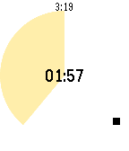

<!-- Generated by scripts/update_app_directory.py: do not edit by hand -->
[← All Pebble Developers](../developers.md)

# Akihiro Uchida

*1 app · Last updated 2026-10-12 · [About these lists](../about-app-lists.md)*

Links: [Pebble App Store](https://apps.repebble.com/apps/dev/akihiro-uchida_567155e246ebac9661000023) · [GitHub (uchida)](https://github.com/uchida)

<h2 class="app-name" id="app-569061bfd5ba00104e000016"><a href="https://apps.repebble.com/569061bfd5ba00104e000016">Limone</a> v0.3</h2>
<a class="app-source" href="https://github.com/uchida/limone-watchapp/" title="Source code" data-search-exclude>View source</a>

App

Released 2016-01-09 Updated 2016-01-17

Runs on: Round 2, Time 2, Pebble 2 Duo, Pebble 2, Time Round, Time, Classic

A simple pomodoro timer for Pebble, to notify 25 minutes work finished and after take 5 minutes break. Optionally supports to trigger IFTTT Maker channel and show today&#x27;s tasks in Todoist.

