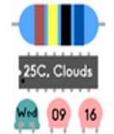

<!-- Generated by scripts/update_app_directory.py: do not edit by hand -->
[← All Pebble Developers](../developers.md)

# Akira

*1 watchface · Last updated 2026-10-12 · [About these lists](../about-app-lists.md)*

Links: [Pebble App Store](https://apps.repebble.com/apps/dev/akira_55b7f7c7c156bd8af600009e) · [GitHub (Akirakira)](https://github.com/Akirakira)

<h2 class="app-name" id="app-55ffd360421a442114000045"><a href="https://apps.repebble.com/55ffd360421a442114000045">Electric Component Watch</a> v1.0</h2>
<a class="app-source" href="https://github.com/Akirakira/ResiWatch" title="Source code" data-search-exclude>View source</a>

Watchface

No licence Released 2015-09-21 Updated 2015-09-21

Runs on: Time 2, Time

This watch face uses color code of electric resister.

