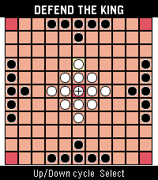
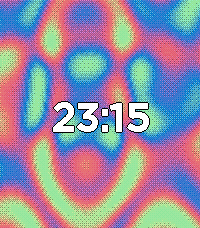
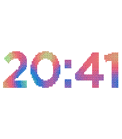
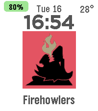

<!-- Generated by scripts/update_app_directory.py: do not edit by hand -->
[← All Pebble Developers](../developers.md)

# Akiva

*3 watchfaces and 1 app · Last updated 2026-10-12 · [About these lists](../about-app-lists.md)*

Links: [Pebble App Store](https://apps.repebble.com/apps/dev/akiva_55c12ae1282aa3bdf31c76ea) · [GitHub (akivaatwood)](https://github.com/akivaatwood)

<button type="button" data-filter="all" aria-pressed="true">All 4</button><button type="button" data-filter="watchface" aria-pressed="false">Watchfaces 3</button><button type="button" data-filter="watchapp" aria-pressed="false">Apps 1</button>

<label class="dev-sort">Sort by <select><option value="updated">Recently updated</option><option value="released">Newest release</option><option value="title">A–Z</option></select></label>

<h2 class="app-name" id="app-b62e83df3cb74a549ef5a06f"><a href="https://apps.repebble.com/b62e83df3cb74a549ef5a06f">Hnefatafl</a> v1.3.0</h2>
<a class="app-source" href="https://github.com/akivaatwood/pebble-hnefatafl" title="Source code" data-search-exclude>View source</a>

App

MIT Released 2026-08-24 Updated 2026-08-24

Runs on: Round 2, Time 2, Pebble 2 Duo, Pebble 2, Time Round, Time, Classic

Hnefatafl app

<h2 class="app-name" id="app-c08f678bfbf946c39abbe702"><a href="https://apps.repebble.com/c08f678bfbf946c39abbe702">Plasma Watchface</a> v1.8.1</h2>
<a class="app-source" href="https://github.com/akivaatwood/pebble-plasma-watchface" title="Source code" data-search-exclude>View source</a>

Watchface

No licence Released 2026-08-03 Updated 2026-08-07

Runs on: Round 2, Time 2, Pebble 2 Duo, Pebble 2, Time Round, Time, Classic

Plasma effect watch face

<h2 class="app-name" id="app-7db473f43c6c4bd7b309a0de"><a href="https://apps.repebble.com/7db473f43c6c4bd7b309a0de">Plasma Numerals</a> v1.3.0</h2>
<a class="app-source" href="https://github.com/akivaatwood/pebble-plasma-numerals-watchface" title="Source code" data-search-exclude>View source</a>

Watchface

No licence Released 2026-08-04 Updated 2026-08-07

Runs on: Round 2, Time 2, Pebble 2 Duo, Pebble 2, Time Round, Time, Classic

Plasma effect numerals

<h2 class="app-name" id="app-0c08a15802184de6a4cd05e8"><a href="https://apps.repebble.com/0c08a15802184de6a4cd05e8">Space Wolves Watchface</a> v1.2</h2>
<a class="app-source" href="https://github.com/akivaatwood/LoganD" title="Source code" data-search-exclude>View source</a>

Watchface

No licence Released 2026-06-14 Updated 2026-07-22

Runs on: Round 2, Time 2, Pebble 2 Duo, Pebble 2, Time Round, Time, Classic

Watchface that displays the Chapter icons for the 12 Space Wolf chapters

