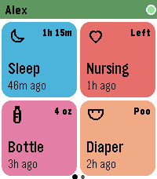

<!-- Generated by scripts/update_app_directory.py: do not edit by hand -->
[← All Pebble Developers](../developers.md)

# akrigline

*1 app · Last updated 2026-11-09 · [About these lists](../about-app-lists.md)*

Links: [Pebble App Store](https://apps.repebble.com/apps/dev/akrigline_2a8ecf59ca5fa4c7fba60f71) · [GitHub (akrigline)](https://github.com/akrigline)

<h2 class="app-name" id="app-a381e879f6e447878f82dc69"><a href="https://apps.repebble.com/a381e879f6e447878f82dc69">nappebble</a> v0.1.0</h2>
<a class="app-source" href="https://github.com/akrigline/nappebble" title="Source code" data-search-exclude>View source</a>

App

MIT Released 2026-11-03 Updated 2026-11-03

Runs on: Time 2

Log your baby&#x27;s feeds, diapers and sleep to nappi from your wrist. nappebble puts nappi on your Pebble Time 2. Open it, tap a big colour tile, and the entry is logged. Most things take two taps…

