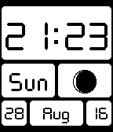

<!-- Generated by scripts/update_app_directory.py: do not edit by hand -->
[← All Pebble Developers](../developers.md)

# Akrs

*1 watchface · Last updated 2026-10-12 · [About these lists](../about-app-lists.md)*

Links: [Pebble App Store](https://apps.repebble.com/apps/dev/akrs_52be2e4c007c1e4815000011) · [GitHub (akrs)](https://github.com/akrs)

<h2 class="app-name" id="app-52d0d8b01d006df8f90000b9"><a href="https://apps.repebble.com/52d0d8b01d006df8f90000b9">Moontiles</a> v3.0</h2>
<a class="app-source" href="https://github.com/akrs/moontiles/" title="Source code" data-search-exclude>View source</a>

Watchface

No licence Released 2014-01-11 Updated 2016-08-29

Runs on: Time 2, Pebble 2 Duo, Pebble 2, Time, Classic

A simple watchface that displays the time, date and moon phase. For the moon phase, an icon for one of 14 phases of the moon is displayed with a different representation for waxing and waning…

