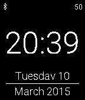

<!-- Generated by scripts/update_app_directory.py: do not edit by hand -->
[← All Pebble Developers](../developers.md)

# Akwaryoum

*1 watchface · Last updated 2026-10-12 · [About these lists](../about-app-lists.md)*

Links: [Pebble App Store](https://apps.repebble.com/apps/dev/akwaryoum_54dbb83b097dffd2400000b5) · [GitHub (Akwaryoum)](https://github.com/Akwaryoum)

<h2 class="app-name" id="app-54fc260fd7e692f72200003d"><a href="https://apps.repebble.com/54fc260fd7e692f72200003d">SimpleFace</a> v2.1</h2>
<a class="app-source" href="https://github.com/Akwaryoum/Simpleface" title="Source code" data-search-exclude>View source</a>

Watchface

MIT Released 2015-03-08 Updated 2015-08-01

Runs on: Time 2, Pebble 2 Duo, Pebble 2, Time, Classic

English A simple configurable watchface who displays: time, date, year bluetooth connection and battery percentage. Last two can be switched off, and a notification can be made in case of…

