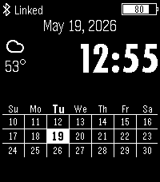

<!-- Generated by scripts/update_app_directory.py: do not edit by hand -->
[← All Pebble Developers](../developers.md)

# Alan Johnson

*2 watchfaces · Last updated 2026-10-12 · [About these lists](../about-app-lists.md)*

Links: [Pebble App Store](https://apps.repebble.com/apps/dev/alan-johnson_67a284c581c36f00092a6a3b) · [GitHub (alan-johnson)](https://github.com/alan-johnson) · [Website (handsbreadth.com)](https://handsbreadth.com)

<button type="button" data-filter="all" aria-pressed="true">All 2</button><button type="button" data-filter="watchface" aria-pressed="false">Watchfaces 2</button><button type="button" data-filter="watchapp" aria-pressed="false" disabled>Apps 0</button>

<label class="dev-sort">Sort by <select><option value="updated">Recently updated</option><option value="released">Newest release</option><option value="title">A–Z</option></select></label>

<h2 class="app-name" id="app-916e2f28a998413f8390fb08"><a href="https://apps.repebble.com/916e2f28a998413f8390fb08">Pebble Timely</a> v3.3.0</h2>
<a class="app-source" href="https://github.com/alan-johnson/PebbleTimely" title="Source code" data-search-exclude>View source</a>

Watchface

GPL-3.0 Released 2026-05-19 Updated 2026-05-25

Runs on: Time 2, Pebble 2 Duo, Pebble 2, Time, Classic

Based on the original Timely watchface by Martin Norland &lt;cyn@cyn.org&gt;, original source: https://github.com/cynorg/PebbleTimely. This is a Watchface for the Pebble Watch. It shows the current date…

<h2 class="app-name" id="app-69e1089397c2500009d7dfba"><a href="https://apps.repebble.com/69e1089397c2500009d7dfba">hb-vibe</a> v1.0</h2>
<a class="app-source" href="https://github.com/alan-johnson/hb-vibe" title="Source code" data-search-exclude>View source</a>

Watchface · <a href="https://forum.rebble.io/t/885" title="Discuss this app on the Rebble forum" data-search-exclude>Forum thread</a>

No licence Released 2026-04-16 Updated 2026-04-16

Runs on: Round 2, Time 2, Pebble 2 Duo, Pebble 2, Time Round, Time, Classic

Inspired by a watch face worn by Eric Migicovsky, hb-vibe has plenty of features in an easy to read design. Features include a rotating text display for date, battery charge percentage, current…

