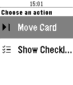

<!-- Generated by scripts/update_app_directory.py: do not edit by hand -->
[← All Pebble Developers](../developers.md)

# Alberto Velo

*1 app · Last updated 2026-10-12 · [About these lists](../about-app-lists.md)*

Links: [Pebble App Store](https://apps.repebble.com/apps/dev/alberto-velo_568fb54a05f633497c00003f) · [GitHub (trapias)](https://github.com/trapias) · [Website (trapias.github.io)](http://trapias.github.io/blog/Petrello)

<h2 class="app-name" id="app-575e54858e426b7cab00000f"><a href="https://apps.repebble.com/575e54858e426b7cab00000f">Petrello</a> v1.9</h2>
<a class="app-source" href="https://github.com/trapias/Petrello" title="Source code" data-search-exclude>View source</a>

App

Released 2016-06-13 Updated 2019-07-24

Runs on: Round 2, Time 2, Pebble 2 Duo, Pebble 2, Time Round, Time, Classic

Petrello is a simple Trello client, allowing you to navigate through your boards, check/uncheck checklist item, move cards within lists and add due cards to your timeline. More info at…

