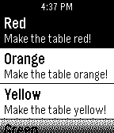

<!-- Generated by scripts/update_app_directory.py: do not edit by hand -->
[← All Pebble Developers](../developers.md)

# Alec Harley

*1 app · Last updated 2026-10-12 · [About these lists](../about-app-lists.md)*

Links: [Pebble App Store](https://apps.repebble.com/apps/dev/alec-harley_531aa3b0af83c14a12000200) · [GitHub (obja)](https://github.com/obja)

<h2 class="app-name" id="app-53a3df8b694928250f00015e"><a href="https://apps.repebble.com/53a3df8b694928250f00015e">DeskLights128</a> v1.1</h2>
<a class="app-source" href="https://github.com/obja/Desklights128" title="Source code" data-search-exclude>View source</a>

App

Released 2014-06-20 Updated 2014-07-06

Runs on: Time 2, Pebble 2 Duo, Pebble 2, Time, Classic

Controls a DeskLights 2.0 table with custom commands.

