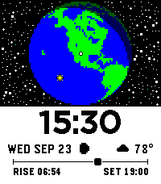

<!-- Generated by scripts/update_app_directory.py: do not edit by hand -->
[← All Pebble Developers](../developers.md)

# Alec Hudson

*1 watchface · Last updated 2026-10-11 · [About these lists](../about-app-lists.md)*

Links: [Pebble App Store](https://apps.repebble.com/apps/dev/alec-hudson_4462b3475108118213285c80) · [GitHub (alechudson)](https://github.com/alechudson)

<h2 class="app-name" id="app-d58b889bab2c41cdb5a1b267"><a href="https://apps.repebble.com/d58b889bab2c41cdb5a1b267">Yearlight</a> v1.0.8</h2>
<a class="app-source" href="https://github.com/alechudson/yearlight" title="Source code" data-search-exclude>View source</a>

Watchface

Other Released 2026-09-24 Updated 2026-09-25

Runs on: Time 2

Watch sunlight move across the Earth, centred on where you are. ★ A year of stars The sky around the globe fills with one star for every day of the year. On January 1st there&#x27;s a single star; by…

